# architect

A Rust framework for local-first, multiplayer, collaborative apps: declare each service and document once, and architect gives you every wire, offline and peer-to-peer sync, and one Action List that keys, menus, scripts, extensions and MCP all run.

[](https://github.com/FastTrackStudios/architect/actions/workflows/checks.yml?query=branch%3Amain) [](https://github.com/FastTrackStudios/architect/tags) [](#license)

Pre-1.0: any release may break the API · Rust 1.99.1 (`rust-toolchain.toml`) · not on crates.io: depend on a release tag.

## The 30-second version

```rust
use uuid::Uuid;

// A service. From this one trait: the vox service, `POST /greeter/greet`,
// `POST /greeter/count`, `/greeter/greeted` as Server-Sent Events,
// `GreeterClient` (vox) and `GreeterHttpClient`, both implementing
// `Greeter`; and with `actions`, the Action List actions `GREETER_GREET`
// and `GREETER_COUNT` that keys, menus, scripts and MCP run.
#[architect::service(actions)]
pub trait Greeter {
    async fn greet(&self, name: String) -> Result<String, GreetError>;
    #[action(effect = read_only)]
    async fn count(&self) -> Result<u32, GreetError>;
    #[subscribe]
    fn greeted(&self) -> String;
}

// An error: the wire derives, an HTTP status and code per variant, and
// the `Transport(String)` variant that lets the clients implement the trait.
#[architect::error]
#[derive(Eq)]
pub enum GreetError {
    #[error("nobody is called {0}")]
    #[architect(http_status = 404)]
    Unknown(String),
}

// An entity: `NoteCreate`, `NoteUpdate`, `NoteList`, the `NoteRepo` trait
// (get / list / create / update / delete), its clients and routes, the
// `NoteEvent` feed, the SeaORM storage and the `NoteMigration`.
#[architect::entity(table_name = "notes", repo, events)]
pub struct Note {
    #[architect(primary_key, auto_increment = false, on_create = Uuid::new_v4())]
    pub id: Uuid,
    #[architect(filterable, sortable)]
    pub title: String,
    pub body: String,
}
```

A backend implements the traits and lists its bundle; one server serves
vox over WebSocket, the HTTP face and `/health` from it
(`examples/greeter/src/lib.rs`, `examples/greeter/src/main.rs`):

```sh
devenv shell
GREETER_BIND=127.0.0.1:4040 cargo run -p example-greeter
curl -XPOST localhost:4040/greeter/greet -d '{"name":"cody"}'   # "hello cody"
curl -N     localhost:4040/greeter/greeted                       # data: "hello cody"
```

Because the clients implement the trait, one scenario test covers every
wire:

```rust
async fn scenario(client: &impl Greeter) {
    assert_eq!(client.greet("cody".into()).await.unwrap(), "hello cody");
}

scenario(&Memory::default()).await;                              // in process
scenario(&local.establish::<GreeterClient>().await?).await;      // vox
scenario(&GreeterHttpClient::at("http://127.0.0.1:4040")).await; // HTTP
```

## What it gives you

| Area | What you get | Start at |
|---|---|---|
| Contracts | Services and entities declared once: vox (in process, WebSocket, iroh) and HTTP+JSON with SSE from one trait, typed errors, SeaORM storage and migrations, one `EngineHost` server | `docs/content/features/services-and-entities.md` |
| Commands | The Action List: every capability an action by id with a JSON Schema, run by the ⌘K palette, ⌘O, menus, keys, the CLI and MCP | `docs/content/features/commands.md` |
| Input | Key bindings with chords, sequences, modes and which-key, the person's own keymap and a binding editor, MIDI and OSC | `docs/content/features/key-bindings.md` |
| Scripting and extensions | Luau scripts over the Action List as one undo step, saved scripts as actions; extensions from registries with manifests, hot reload, process extensions with remote views | `docs/content/features/scripting.md`, `docs/content/features/extensions.md` |
| MCP | An app's Action List served to a model, one tool per action, or five generic tools over the whole list, discoverable on loopback | `features/mcp/src/lib.rs` |
| Documents | CRDT documents (Loro) with kinds and migrations, named undo, and a crash-safe file per document with branches and versions | `docs/content/features/documents.md`, `docs/content/features/document-file.md` |
| Sync and collaboration | Org sync, peer to peer over iroh with share links and LAN discovery, presence (pointers, selections) and collaborative text | `docs/content/features/org-sync.md`, `docs/content/features/peer-to-peer.md`, `docs/content/features/presence-and-text.md` |
| Blobs and Files | Bytes by sha256, fetched on demand from a peer or a server, pinned and collected; an org's files with versions, quota and access | `docs/content/features/blobs.md`, `docs/content/features/files.md` |
| Identity | Sign-in against one auth server, sessions and devices, permissions on every service call, organizations as the scope of everything | `docs/content/features/auth.md`, `docs/content/features/permissions.md`, `docs/content/features/organizations.md` |
| Settings | `#[derive(Settings)]` on a struct, values by scope (device, the person's synced, the project's) under an org's defaults and locks, a settings page with search | `docs/content/features/settings.md` |
| Shell and workspace | The app frame, tab groups in splits, docks, stacked tabs, pop-out windows, screensets; menus native on macOS, Linux and iPadOS, in the window elsewhere | `docs/content/features/workspace-and-shell.md`, `docs/content/features/menus.md` |
| Telemetry | Each call as a wide event with stage timings, `rpc.server.duration`, one trace across a caller and its calls | `docs/content/features/telemetry.md` |

## The Architect app

Architect is also an app, built here on the framework: a desktop app
(`apps/desktop`, `architect-desktop`) and a mobile app (`apps/mobile`),
both mounting one UI crate (`apps/ui`, `architect-app`), and the start of
a web app (`apps/web`: its shell and sign-in, served with the landing page
and the docs at architect.fasttrackstudio.app). It opens a vault (a folder of markdown, an Obsidian
vault as it is) in the workspace and the navigator, with extensions,
themes, ⌘K and the Action List agents drive. Its first run opens or
creates a vault or explores the demo vault (`apps/ui/demo-vault`), then
offers the tour; sign-in and sync come later (#383). Run it with
`just app`. Its dev sandbox (`apps/sandbox`, `just sandbox`) is the same
app on made-up data, with the example extensions, where the goldens,
scenarios and films run.

## Tour

The Architect app and its sandbox (`apps/sandbox`) carry a guided tour
(`apps/ui/tours/architect-tour.styx`) of every system: the shell,
the workspace, runtime theming, the Action List and agents, extensions,
pages, and the embedded views. Each chapter moves the live app to one
system, rings the control to try and says what it is in a few lines;
Next, Back and Skip move through it, and it remembers where you
stopped. It starts on the sandbox's first launch, after the Architect
app's first run, and from ⌘K › Take the tour.

```sh
devenv up    # the sandbox under dx serve, plus Teley and its collector
just sandbox     # or the sandbox alone, without dx
```

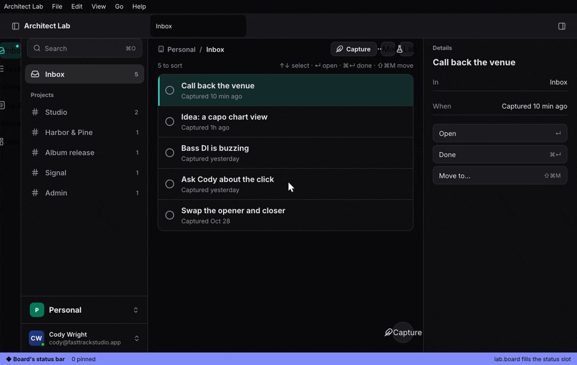

The tour is a guide scenario, `apps/ui/tours/architect-tour.styx`,
played live by `architect-guide`; `apps/sandbox/media/tests/tour.rs` plays it
chapter by chapter and checks each one's target is on screen.

## Feature gallery

Each one is a scenario in `apps/sandbox/scenarios`, filmed headlessly by
`just media` and played as a test by `just media-test`.

`THEME_SET` restyles every window at once, a pop-out included; a light/dark pair follows Appearance ([doc](docs/content/architecture/theming.md), `apps/sandbox/scenarios/theme-live-everywhere.styx`):

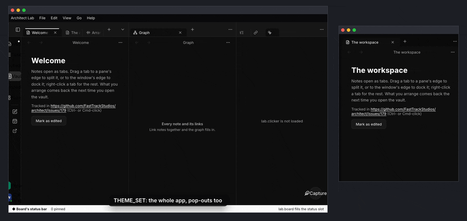

A theme file saved: the app follows; a `mix(…)` token, a `$ref`, and a broken one drawn magenta ([doc](docs/content/architecture/theming.md), `apps/sandbox/scenarios/theme-file-live.styx`):

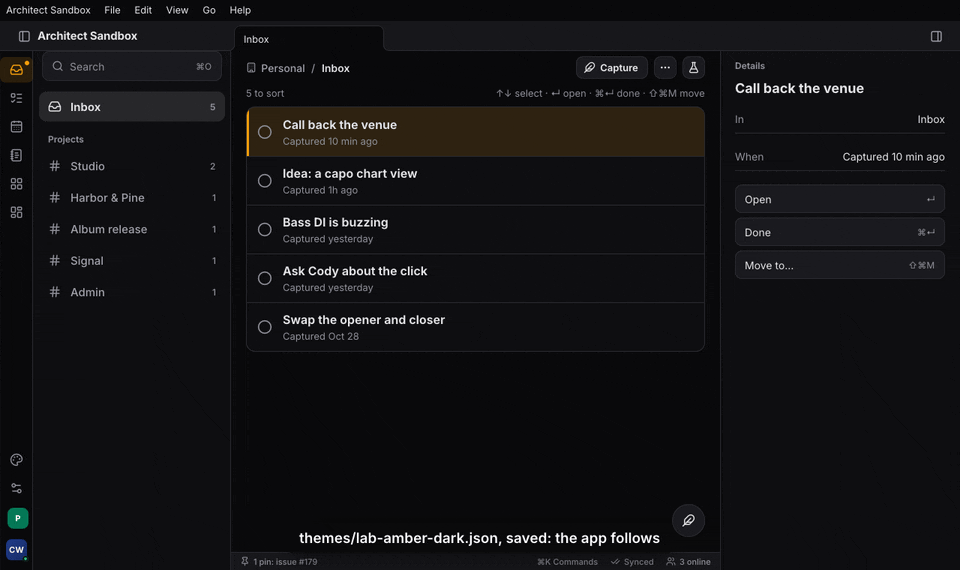

`EXT_CLONE` copies an extension into `dev/`; its edited manifest reloads on save ([doc](docs/content/architecture/extensions.md), `apps/sandbox/scenarios/extension-clone-live.styx`):

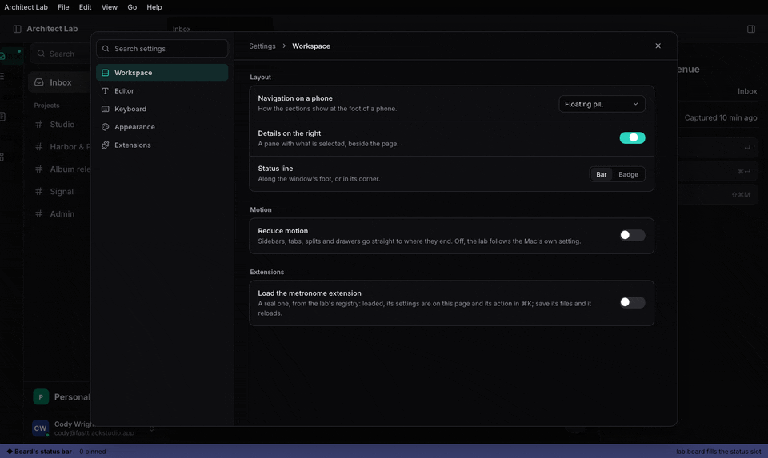

A TSX page edited live; a broken save keeps the last good page and writes `board.tsx.error` ([doc](docs/content/architecture/pages.md), `apps/sandbox/scenarios/page-edit-live.styx`):

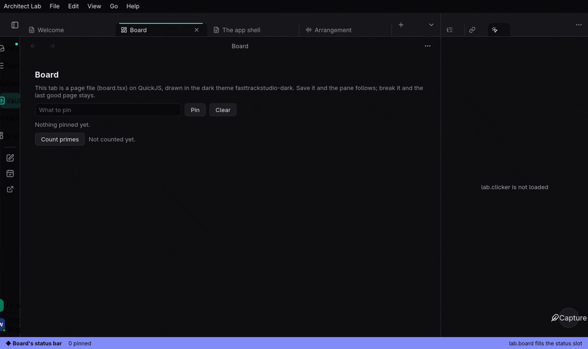

Primes counted in a worker, a slow view marked busy, the rest of the app answering ([doc](docs/content/architecture/extensions.md), `apps/sandbox/scenarios/workers-stay-responsive.styx`):

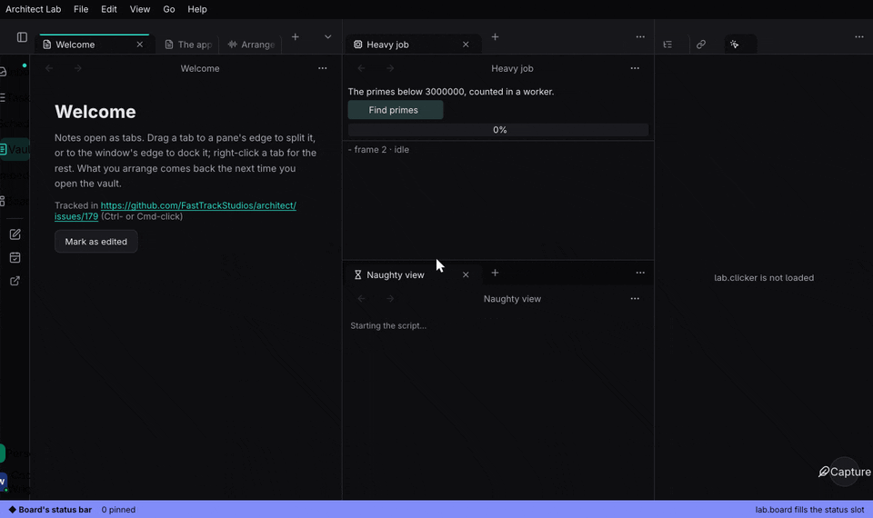

Inline embeds: a ```` ```kf ```` fence drawn by an extension inside a note, plain again when it is off ([doc](docs/content/architecture/extensions.md), `apps/sandbox/scenarios/embeds-in-a-note.styx`):

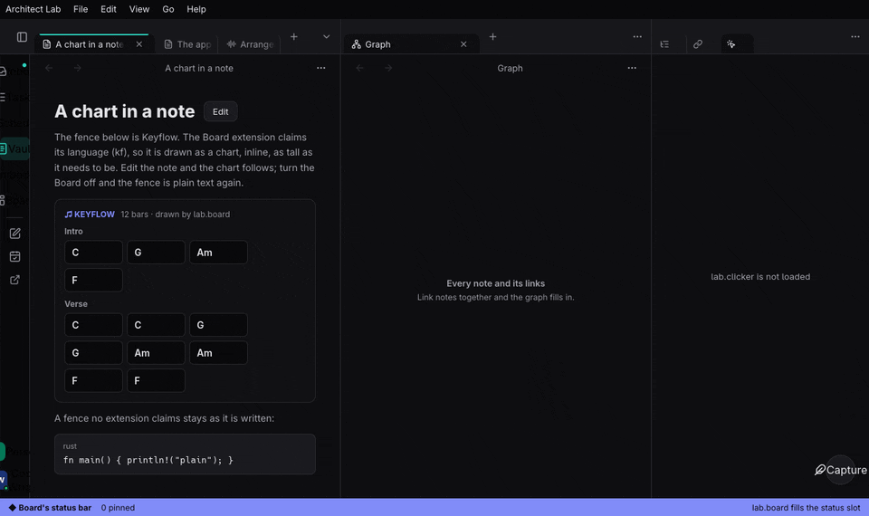

The extensions manager: extensions, scripts, workers, themes, layouts and pages in one place ([doc](docs/content/architecture/extensions.md), `apps/sandbox/scenarios/extensions-manager.styx`):

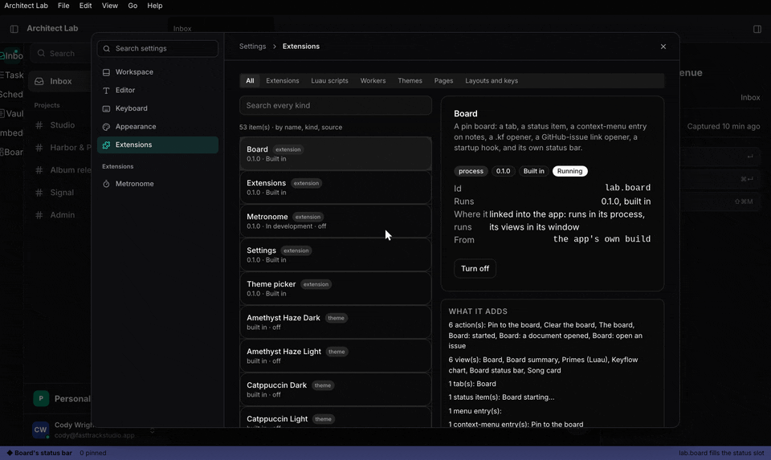

Settings arriving from an extension: the metronome loaded, its section on the settings page ([doc](docs/content/architecture/settings-page.md), `apps/sandbox/scenarios/extension-metronome-load.styx`):

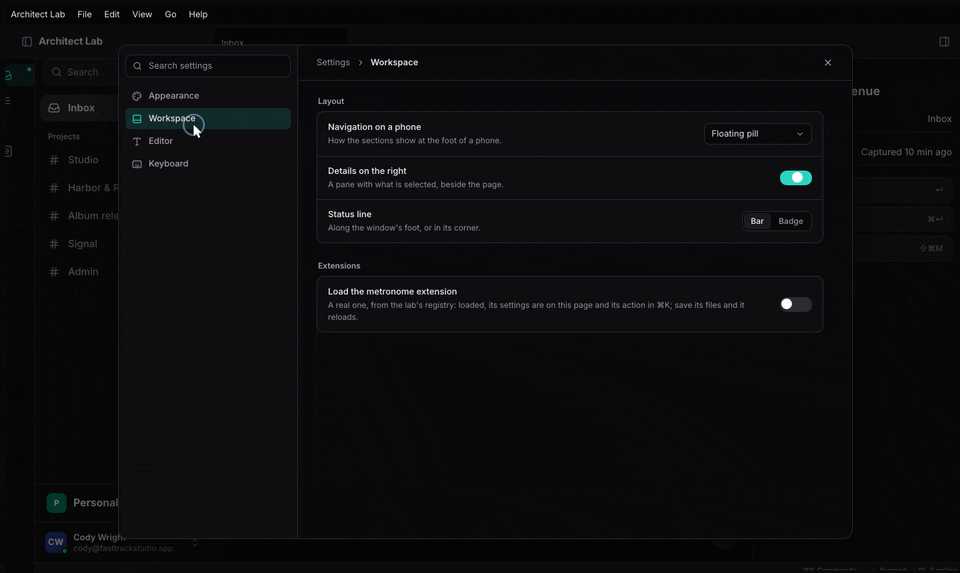

Tabs in the title row, and a sidebar each page starts open or folded to a rail ([doc](docs/content/architecture/app-shell.md), `apps/sandbox/scenarios/shell-title-tabs-rail.styx`):

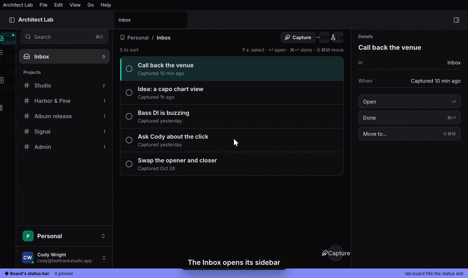

An agent drives the app over the CLI: the same Action List as ⌘K, the menus and MCP ([doc](docs/content/guide/cli-and-mcp.md), `apps/sandbox/scenarios/agent-drives-the-lab.styx`):

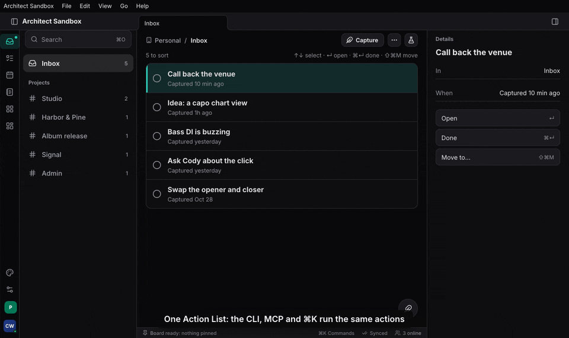

The workspace: splits by dragging, stacked tabs, and a sidebar detached into its own window ([doc](docs/content/architecture/workspace.md), `apps/sandbox/scenarios/showcase-layout.styx`):


## Install

Prerequisites: Nix and devenv for the dev shell (`devenv.nix`), or the
pinned Rust toolchain and the GTK/WebKit libraries the desktop crates
link against.

```toml
[dependencies]
architect = { git = "https://github.com/FastTrackStudios/architect", tag = "vX.Y.Z", features = ["client"] }
```

Use the newest tag from [Releases](https://github.com/FastTrackStudios/architect/releases),
and one tag for every crate in a `Cargo.lock`: vox handshakes fail across
mismatched revisions. The feature crates (`architect-workspace`,
`architect-commands`, `crdt`, …) come from the same repository and tag.
A consumer also carries the root `Cargo.toml`'s `[patch.crates-io]`
entries for the vendored forks.

| Feature | Turns on |
|---|---|
| `client` | Typed vox clients, the optimistic store and forms, for a UI crate (wasm or desktop) |
| `server` | vox, SeaORM storage, the axum WebSocket transport and the HTTP face, for a server |
| `host` | `EngineHost`: one binary serving `/vox`, `/health`, the HTTP face and an SPA |
| `iroh`, `iroh-lan` | vox over iroh QUIC, dialled by endpoint id; LAN discovery |
| `action-list` | The Action List registry |
| `local` | The in-process transport, native and wasm |

Every flag, what it implies and what it pulls: `docs/content/architecture/features.md`.

## Run the examples

```sh
devenv shell
cargo test -p example-greeter       # one scenario in process, over vox and over HTTP
cargo test -p example-scripting     # Luau over an Action List, one undo step per run
cargo run  -p example-scripting -- run examples/scripting/scripts/close_tag.luau '{"tag":"home"}'
cargo build -p example-extension-counter && cargo run -p example-extension-host
```

The script run answers with `{result, log, ran, undo}`: what the script
returned, what it printed, the actions it ran and its one undo step. The
extension host opens a window with a timeline, the extensions' overlays
and tool windows, a process extension's view and the settings page. The
Architect app runs with `dx serve --platform desktop --renderer native`
in `apps/desktop`, and its sandbox, where the shell and workspace are
designed, the same way in `apps/sandbox` (`apps/sandbox/README.md`). `cargo xtask feature new <name>` scaffolds a new
feature crate with a passing test.

## Workspace

| Path | What it is |
|---|---|
| `crates/architect` | The crate you depend on: services, layers, hosts, transports, the Action List, behind features |
| `crates/architect-derive`, `crates/architect-rpc-derive`, `crates/architect-action-derive` | The entity, error, service and action macros |
| `features/` | One crate per feature: `crdt`, `files`, `auth`, `orgs`, `permissions`, `settings`, `commands`, `input`, `mcp`, `scripting`, `extensions`, `canvas`, `shell`, `workspace`, `ui`, `telemetry`, `guide` and more |
| `examples/greeter` | The reference feature: entity, service, error, backend, server, tests over every wire |
| `examples/scripting` | A task board scripted from Luau, saved scripts as actions, MCP |
| `examples/extension` | A registry, a Luau extension, a process extension and the host that loads them |
| `apps/desktop`, `apps/mobile`, `apps/web` | The Architect app on a desk, a phone and the web (the web front end: landing page, docs, the app's shell) |
| `apps/ui` | The app's UI (`architect-app`), its tour and the demo vault |
| `apps/sandbox` | The dev sandbox: the app on made-up data, the example extensions (Board, Clicker, WASI Counter, the registry's), the guide scenarios, goldens and films |
| `apps/auth-server`, `apps/mock-oauth` | The identity server, and a mock OAuth provider for its tests |
| `skills/architect` | The agent skill |
| `xtask` | `cargo xtask`: `feature new`, `boundaries`, `docs`, `tags`, `fleet-bump` |

## Documentation

- Getting started: `docs/content/getting-started/_index.md`, then the
  walkthroughs `docs/content/getting-started/walkthrough.md`,
  `docs/content/getting-started/scripting.md` and
  `docs/content/getting-started/extension.md`.
- The guide, chapter by chapter from the contract to extensions:
  `docs/content/guide/_index.md`.
- One page per feature, with the least code to use it and the tests to
  read: `docs/content/features/_index.md`.
- Design pages: `docs/content/architecture/_index.md`. The crate map and
  macro attributes: `docs/content/reference/_index.md`.
- What shipped in which tag: `CHANGELOG.md`.

## For coding agents

`skills/architect/` is the skill agents load to build on architect: the
rules, an API map and recipes, with every repo path checked by
`cargo xtask docs`. The fleet's skill sync vendors it from each release
tag; in this repo `.claude/skills/architect` links to it, and
`just skill-install` links this checkout's copy into `~/.claude/skills`
and `~/.codex/skills`. `AGENTS.md` holds the repo's
rules for agents: what a PR updates and how docs cite code.

## When not to use it

- Your app is not Rust. architect is Rust on both ends; a web UI is
  Dioxus compiled to wasm, a desktop UI Dioxus on Blitz.
- You need a stable API. It is pre-1.0, tags land often, and breaking
  changes land in any of them.
- You build outside its pins. It tracks one toolchain, a pinned Dioxus
  revision and FastTrackStudios forks of vox, facet and dioxus-native.
- You need CI coverage on macOS, Windows or iOS. CI builds and tests on
  Linux (`ubuntu-latest`) and checks the wasm build; nothing else runs
  there.

## Contributing

`devenv shell` (or direnv, through `.envrc`), then `just check`, `just test` and `just docs-check`; CI
runs the full suite on every push to `main` (`.github/workflows/checks.yml`).
A PR that adds, renames or removes public API or a feature flag updates
`skills/architect/` in the same PR.

## License

Licensed under either of [Apache License, Version 2.0](LICENSE-APACHE)
or [MIT license](LICENSE-MIT), at your option. Unless you explicitly
state otherwise, any contribution intentionally submitted for inclusion
in this work, as defined in the Apache-2.0 license, shall be dual
licensed as above, without any additional terms or conditions.
