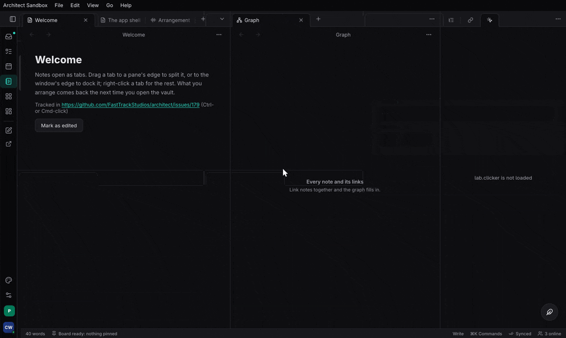

+++
title = "Embedded views: view kinds"
description = "One contract every view mounts through — a Dioxus component, a GPU scene, a web view, a Frame surface, an agent's generated UI — a registry of the kinds an app provides, where each can be shown and mounted, and what each may do."
weight = 68
+++

> **Status: the contract and the registry landed (architect#220).** The
> model is `features/workspace/src/kinds.rs` (`ViewKinds`, `KindSpec`,
> `ViewHost`, `Placement`, `Capability`, `KindError`), wasm-clean in
> `architect-workspace`'s default build; the contract a kind mounts
> through is `features/workspace/src/ctx.rs` `ViewCtx` (feature `ctx`).
> The workspace's own `View` is the built-in `dioxus` kind
> (`features/workspace/src/host/mod.rs` `View`, `Views::resolve`), and an
> extension's `[[views]] kind` is checked when it loads
> (`features/extensions/src/host.rs` `LoadError::ViewKind`,
> `features/extensions/tests/view_kinds.rs`). `dioxus` is built in, and
> `paint` is the first GPU kind (#221): a view that records an `anyrender`
> scene each frame, drawn in-process by Blitz in the pane, with a real
> `ViewCtx` and typed host data ([Paint views](#paint-views), features
> `paint` and `paint-ui`). An app registers it with `KindSpec::paint`.
> A host-driven WebGL2 canvas for the same scene is available with feature
> `paint-web`. Other kinds and hosts remain separate work: raw wgpu (#221), WebView/HTML
> (#222), ImGui from Luau (#223), Frame surfaces (#224, in
> FastTrackStudios/frame; a minimal `frame.surface` provider is the
> frame-view crate), Dioxus in-process and remote (#225), generative
> UI (#226). Its A2UI payload landed in #228:
> [A2UI](@/features/a2ui.md) (`features/a2ui/src/lib.rs`), drawn as a
> `dioxus` view.

A workspace pane shows a **view**: `"session.mixer"`, `"vault.note"`. What
*draws* a view is its **kind**. Until now there was one, a Dioxus
component in the app's own document. Studio, Task and extensions also
want GPU-painted scenes, web content, script UIs, Frame surfaces and
agents' generated UIs inside panes. Without one contract each of those
would get its own pane plumbing, input path and lifecycle. With it, a
kind is declared once, mounts through one context, and is refused with a
reason where it cannot run.

```
an app links crates             ViewKinds                 a host mounts a view
──────────────────              ─────────                 ────────────────────
architect   ── dioxus ──▶  ┌─────────────────┐   resolve_for(kind, host, placement)
frame-view  ── frame.surface▶│ id, provider,   │ ──▶  Ok(KindSpec) → provider gets a ViewCtx
studio      ── gpu ─────▶  │ hosts, placements│ ──▶  Err(KindError) → the reason, in place
                           │ capabilities,   │
                           │ parts           │
                           └─────────────────┘
                                   ▲
extension.toml  [[views]] kind = "…" ── Host::load refuses an unknown kind
```

## The dependency direction

architect defines the contract; other repos implement kinds. architect
never depends on a provider, not even optionally on Frame:

- Frame's editor and integration already depend on architect. An
  optional architect → Frame dependency would be a package cycle, and the
  two git-tag pins would have to move in lockstep (the one-version rule
  for vox, facet and Dioxus already makes the fleet's bumps painful).
- The same contract has to serve raw wgpu, a web view, ImGui, remote
  Dioxus and generated UI. With Frame inside, the contract would be shaped
  to fit Frame.
- Frame releases on its own cadence, and an app that does not use Frame
  never builds Vello effects or figcraft.

So a provider crate (`frame-view`, `studio`'s GPU host) depends on
`architect-workspace` (feature `ctx`) and registers its kinds into the
app's `ViewKinds` at startup.

## The registry

`features/workspace/src/kinds.rs` `ViewKinds` holds one `KindSpec` per
kind:

| Field | Meaning |
|---|---|
| `id` (`KindId`) | `"dioxus"`, `"gpu"`, `"webview"`, `"frame.surface"`, `"genui"` |
| `provider` | the crate that registered it; `"architect"` for `dioxus` |
| `hosts` (`Hosts`) | what it can be shown in (`ViewHost`): `blitz` (a desk window), `web` (the app built to wasm), `webview` (a wry view in a pane), `plugin` (a nice-plug editor window) |
| `placements` (`Placements`) | where it mounts (`Placement`): a workspace `Pane` (tab, dock, float, pop-out), a canvas `Overlay`, an inline `Embed` (#180), a `PluginWindow` |
| `capabilities` (`Capabilities`) | what it may do (`Capability`): `input`, `ime`, `gpu`, `document`, `actions`, `network`, `untrusted` |
| `parts` | a composite's parts (below) |

- `ViewKinds::new` has the built-in `dioxus` kind (`KindSpec::dioxus`);
  `ViewKinds::empty` has none.
- `ViewKinds::register` adds a kind; an id already provided is refused
  (`KindError::Taken`, naming the provider).
- `ViewKinds::resolve` finds a kind or says why not
  (`KindError::Unknown`, listing the kinds there are);
  `ViewKinds::resolve_for` also checks the host and placement
  (`KindError::Host`, `KindError::Placement`).

The workspace's `Views` carries the app's kinds (`Views::with_kinds`, the
built-in one alone by default). A pane resolves its view through
`Views::resolve`: a view whose kind is not here, or not for this host,
shows the reason in the pane, and the pane keeps its state until the kind
comes back, the same as a view the app does not have.

## The contract: `ViewCtx`

`features/workspace/src/ctx.rs` `ViewCtx` is what every kind is given when
it mounts. It has no Dioxus and no clock of its own, so it builds on wasm,
in a plugin and in a test.

| Field | What it is | How the `dioxus` kind gets the same today |
|---|---|---|
| `pane` | the pane's `PaneId` | `use_pane` |
| `kind`, `host`, `placement` | what draws it, and where | always `dioxus`, the window's host, a pane |
| `geometry` (`Geometry`) | size in logical pixels, and the scale factor | its own layout |
| `actions` (`ActionList`) | the host's Action List: the only way a view changes anything outside itself | `use_action_list`, the commands context |
| `caller` (`ActionCaller`) | who its runs are made as: the person, or an agent for generated UI; the authorizer and confirmation tickets see it | the app's caller |
| `doc` (`DocRef`) | a `CrdtDoc`, the container path its data lives at, and the `crdt::History` its edits go through | `use_synced_doc` and the app's history |
| `theme` (`ThemeTokens`) | the theme as tokens by name, for a kind that does not draw in a DOM | `ShellTheme` in context |
| `input` (`InputSink`) | pointer, wheel, touch, keys, IME and focus (`ViewInput`), pushed by the host and drained by the kind | DOM events |
| `clock` (`FrameClock`) | the host's clock and a per-frame budget; `Frame::over` says when to skip work | the window's frame |
| `extras` (`Extras`) | typed handles a host adds: the canvas host's publisher for the `Spaces` a view draws in (`features/canvas/src/space.rs` `Spaces`), a frame engine; shared typed data, `HostData<T>` (`Extras::with_data`, read with `ViewCtx::data`) | Dioxus context |

`HostData<T>` is one value of the host's type, shared between the host
and the view: `read` and `update` under a lock, a `version` that moves on
every write so either side can tell it changed, and for a `Facet` type its
schema (`HostData::shape`) and JSON both ways (`to_json`, `set_json`,
which refuses what is not a `T` and keeps the value). A pane's own state
can be typed the same way: `PaneHandle::state_as` reads it as a `Facet`
type (`None` while it is something else, such as text from before), and
`PaneHandle::set_state_as` keeps it as that type's JSON.

The input set is the one remote views carry across a process boundary
(#176), so a kind sees the same events in-process and remotely. The frame
budget is the host's, not the kind's: a kind over budget draws less, and
never delays the host's frame (or reaches an audio thread).

The `dioxus` kind keeps reading these through hooks, so no existing view
changed (`View` gained `draws`, which is `dioxus` unless a provider's
`View::drawn_by` says otherwise). A provider for another kind returns a
`View` whose render mounts its kind in the pane, building its `ViewCtx`
from the same hooks; a non-Blitz host (a plugin window) builds the
`ViewCtx` itself.

## Paint views

`features/workspace/src/paint/mod.rs` is the `paint` kind's model (feature
`paint`: `anyrender` and `peniko`, no Dioxus, wasm-clean). A `PaintView`
is given the pane's `ViewCtx` and answers three questions: what an input
event changes (`input`), what this frame looks like (`paint`, an
`anyrender` `Scene` in its own logical pixels), and what is under a point
(`hit`). `Painter` is the host's side: it drains the ctx's `InputSink`
into the view, asks for a frame at the pane's `Geometry` and scales it to
physical pixels, and times each frame into `FrameStats` (the last 1024;
`FrameStats::summary` is the count, p50, p99 and the slowest, on the
host's `FrameClock`). `Marks` is a display list a view can paint from and
hit-test from, so what is drawn and what the pointer finds are one list:
`features/workspace/src/paint/tests.rs`
`paint_and_hit_testing_read_one_list` rasterises 10 000 rectangles and
overlapping bars on the CPU at 1× and 2× and checks the pixel under every
probe against what `hit` finds there, before and after live input
restyles one.

Feature `paint-ui` is the Blitz host (`features/workspace/src/paint/widget.rs`):

- `PaintWidget` is a Blitz custom widget around a `Painter`. Blitz gives
  it its events in the element's own coordinates (they become
  `ViewInput`s: pointer, touch, wheel, keys, IME preedit and commit,
  paste) and asks it for a scene at the element's size; the window's
  renderer (Vello on the GPU) draws that scene in the page. It asks for a
  frame only after input changed something, or every frame while the view
  says it is `animating`.
- `PaintPane { mount }` is the pane: it builds the view's `ViewCtx` from
  the pane (`use_pane`), the app's `Arc<ActionList>` in context (run as
  the app's caller), the shell's theme as tokens (`shell_tokens`, read as
  colours with `ThemeTokens::color`) and a clock from the pane's start.
  `PaintMount::new(make)` names the view, `extras` the host's typed data,
  `stats` a `FrameStats` the host reads elsewhere, `budget` the frame
  budget. Clone `PaintMount::wake_handle` before mounting and call
  `PaintWake::wake` after external data changes; it marks the pane dirty
  and requests a window redraw, including from a worker thread. Each
  mounted pane needs its own handle. Shell theme changes update the
  existing view's `ViewCtx::theme` and request a frame; read tokens during
  input or paint rather than caching them only at construction. A custom
  host can update a `Painter` with `Painter::set_theme`. Mounted Blitz
  document tests in `features/workspace/src/paint/widget/document_tests.rs`
  check both paths against CPU-rendered pixels and confirm they return idle;
  the external wake path is exercised at 1× and 2× display scale.
- A press or a tab gives the widget the focus. While it has it the
  window's IME is on, so composed text reaches the view.

Feature `paint-web` provides `features/workspace/src/paint/web.rs`
`WebPaintSurface`, a host-driven WebGL2 canvas on wasm. The host creates
a `Painter` with a `ViewCtx` for `ViewHost::Web`, passes it and the canvas
to `WebPaintSurface::new`, and registers `KindSpec::paint_web` if it uses
the kinds registry. A host supporting both Blitz and web can register
`KindSpec::paint().host(ViewHost::Web)` once. The view records logical
pixels; the surface sizes the canvas and scales its scene using `Geometry`.
The host forwards `ViewInput` in canvas-local logical pixels, forwards theme
and size changes, and requests a browser animation frame after changes. On
that frame it calls `draw`, and requests another only while `wants_frame`
is true. `draw` skips an idle surface; `invalidate` marks externally changed
data dirty. `hit` uses logical coordinates. WebGL2 initialization, rendering,
lost contexts, and unsupported sizes return errors; context restoration and
DOM event wiring belong to the host. `features/workspace/examples/paint_web.rs`
and `features/workspace/examples/paint_web.html` show the host-driven path.
The browser smoke page `features/workspace/examples/paint_web_test.html`
checks pixels, logical input, 2× sizing, invalid dimensions and idle draws.
From the repository root, build and serve it with a matching `wasm-bindgen`:

```sh
cargo build -p architect-workspace --example paint_web --features paint-web --target wasm32-unknown-unknown
mkdir -p target/paint-web-smoke
wasm-bindgen --target web --no-typescript --out-dir target/paint-web-smoke target/wasm32-unknown-unknown/debug/examples/paint_web.wasm
cp features/workspace/examples/paint_web*.html target/paint-web-smoke/
python3 -m http.server 18763 --directory target/paint-web-smoke
```

Open `paint_web_test.html` in a WebGL2 browser; the page says whether it
passed. Frame counts establish skipped host submissions, not GPU utilization.

Feature `paint-web-ui` adds the Dioxus browser adapter in
`features/workspace/src/paint/web_ui.rs`. Create one `WebPaintMount` per
pane with a factory that returns a `Painter` configured for `ViewHost::Web`,
and render `WebPaintPane { mount, theme }` inside a sized parent. Pass updated
theme tokens as the `theme` prop. Keep `WebPaintMount::wake_handle` and call
`WebPaintWake::wake` on the browser thread after changing shared host data,
including when asynchronous layout completes. Wakes coalesce into animation
frames; views that report animation continue until idle. Pointer positions are
canvas-local logical pixels, while the adapter supplies the device pixel ratio
through geometry once. It forwards pointer, touch, wheel, keyboard, focus and
composition events. The example `features/workspace/examples/paint_web_pane.rs`
shows the mount and wake contract.
The browser check `features/workspace/examples/paint_web_pane_test.html`
exercises hidden mount, theme, wake coalescing, idle frames, logical pointer
input and DPR sizing. Build `paint_web_pane` with feature `paint-web-ui`, run
`wasm-bindgen` on the resulting wasm as above, and serve the example HTML
beside the generated files. Its frame counts measure scene recordings, not GPU
utilization.

Its limits for now: the IME's candidate window is not placed at the
view's caret (no cursor area is set), a write to `HostData` or the
`InputSink` needs an explicit wake, and `FrameStats` times the view's input and
recording, not the GPU's raster. WebGL context restoration and a WebGPU backend
are not implemented; plugin hosts mount no
paint view yet. A Frame
surface can draw through it in-process instead of in a process of its
own.

## Composite kinds

The Frame editor is one view made of several panes that share state per
document: a canvas (a GPU kind) and panels (Layers, Design, Assets,
Bindings: Dioxus kinds). That is a **composite kind**: a `KindSpec` with
`parts`, each `Part` an id and a registered kind.

- `ViewKinds::register` works out a composite's reach from its parts: its
  hosts and placements are those **all** its parts share (within what it
  declared), its capabilities what **any** part has. A part must be
  registered first, cannot itself be a composite, and is named once
  (`KindError::Part`).
- Each part opens as a pane of its own, so the host arranges them like any
  panes: docks, tabs, floats, pop-outs, a preset screenset.
- The parts share one state per document, keyed by the `DocRef`'s
  document and path: the provider keeps a map from that key to its state
  and each part's `ViewCtx` finds it there. Undo is the document's one
  `History`, so ⌘Z steps through every part's edits in one order.

The registration and its checks are built (`kinds.rs` tests
`a_composite_shares_its_parts_reach`); the shared per-document state is
the provider's (`frame-editor`), built with it.

## Extensions name a kind

An extension's manifest names the kind of each view it adds:

```toml
[[views]]
id = "panel"
title = "Panel"
kind = "frame.surface"
```

A view that names none is `dioxus`: a process extension's own Dioxus view,
drawn remotely (`docs/content/features/remote-views.md`). The host checks
every view's kind before anything of the extension starts, through the
same `Host::load` diff as its actions and settings: give it the app's
kinds with `Host::with_view_kinds` (the built-in one alone otherwise). A
kind the app has no provider for refuses the load with its reason,
`its view panel: no provider for the view kind “frame.surface” in this app
(it has: dioxus)`, a loaded copy stays as it was, and nothing of the new
one lands (`features/extensions/tests/view_kinds.rs`).

## The lab's gallery

The lab's Vault keeps one pane of each kind it shows in a screenset,
"Embedded views" (⌘3, the palette's "Load screenset: Embedded views", or
`WORKSPACES_LOAD {"name": "Embedded views"}` over MCP and the CLI): a
Dioxus component, a Luau script's ImGui window, a Frame surface, the
A2UI surfaces and a paint view, each naming its kind
(`apps/lab/ui/src/embedded.rs`). The paint pane (`apps/lab/ui/src/paint.rs`)
draws a 100 × 100 grid of rectangles: the pointer lights the one under it,
a press picks one, the arrow keys move the pick and typed or composed text
is kept, all in the pane's typed host data (`PaintState`). The line under
the grid and `LAB_PAINT_STATE` read it, with the pane's frame count and
p50 / p99 times. The
Frame surface is FastTrackStudios/frame's `frame-surface` program, a
process extension the lab loads when it finds it
(`ARCHITECT_LAB_FRAME_SURFACE`, beside the lab, or on the `PATH`); the lab
declares the `frame.surface` kind itself and never links Frame. It shows
the lab's Frame document, `apps/lab/surfaces/drive.frame`
(`ARCHITECT_LAB_FRAME_DOCUMENT` names another), and a save to it reloads
the surface. The document's knob is bound to the lab's drive and its meter
follows the drive: `LAB_FRAME_SET {"drive": 0.9}` turns the knob and moves
the meter to -0.6 dB, turning the knob by hand sets the drive, and
`LAB_FRAME_STATE` reads the drive, the level, the document and how many
times it was read in. The extension's own actions (`FRAME_SURFACE_LOAD`,
`FRAME_SURFACE_PARAM_SET`, `FRAME_SURFACE_FEED`, `FRAME_SURFACE_STATE`) are
Action List actions too, so MCP and the CLI can drive the surface
directly.

The A2UI pane opens on the release demo (`LAB_A2UI_DEMO`): a form with a
version and a channel, a list of tasks to tick, and a Ship it button. An
agent rendered it, so the button's `LAB_RELEASE_SHIP` waits for the
person's yes before it runs, and its answer is written back into the
surface. The surface can be patched live, for example
`A2UI_PATCH {"messages": [{"updateDataModel": {"surfaceId": "release",
"path": "/tasks/2", "value": {"title": "Notarize the build", "done":
false}}}]}` over MCP adds a task. Scenario:
[`apps/lab/scenarios/embedded-views.styx`](https://github.com/FastTrackStudios/architect/blob/main/apps/lab/scenarios/embedded-views.styx).



## Kinds, hosts and the security model

| Kind | Desk (Blitz) | Web | Plugin window | Capabilities | Security model | Issue |
|---|---|---|---|---|---|---|
| `dioxus` (in-process) | yes | yes | yes (nice-plug-dioxus) | input, ime, document, actions | the app's own code; runs actions as the app's caller | built in |
| Dioxus remote (process extension) | yes | via DOM mount (#174) | no | input, actions | another process: crash-isolated, a placeholder and a restart; only the actions its manifest's capabilities name | #225 |
| `paint` (anyrender scene, in-process) | a Blitz custom widget (`PaintPane`) | not yet | not yet | input, ime, gpu, actions | linked code; draws within its frame budget, never on the audio thread | #221, built |
| GPU view (raw wgpu) | Blitz `CustomPaintSource` | WebGPU/WebGL2 `<canvas>` | nice-plug `custom_paint` | input, gpu, document, actions | linked code; draws within its frame budget, never on the audio thread | #221 |
| WebView / HTML | a wry child view clipped to the pane | a sandboxed `<iframe>` | no | input, untrusted | no network, a custom protocol only, CSP; every call through a host bridge onto the Action List | #222 |
| ImGui from Luau | boxes, then a GPU view | the same | yes, through the GPU view | input, actions, untrusted | Luau's sandbox and the extension's gate | #223 |
| Frame surface | a GPU view | a GPU view | yes (frame-plug) | input, gpu, document, actions | bindings resolve to the extension's own actions and params | #224 |
| Frame editor (composite) | in-process: GPU canvas + Dioxus panels | yes (wasm) | no (opens in the host app) | its parts' | its parts' | #224 |
| Generative UI | on top of the above | the same | Frame or A2UI only | its payload's | a catalog is the boundary; writes confirmed; HTML only in the WebView kind | #226, #228 |

Every kind changes anything outside itself only through the host's Action
List, as `ViewCtx::caller`: the list's authorizer, an extension's gate and
the confirmation tickets for destructive actions
(`crates/architect/src/action_list/confirm.rs` `Confirmation`) apply to it
like any other caller. A kind that runs code the app did not ship says so
(`Capability::Untrusted`), and the extensions page shows it.
