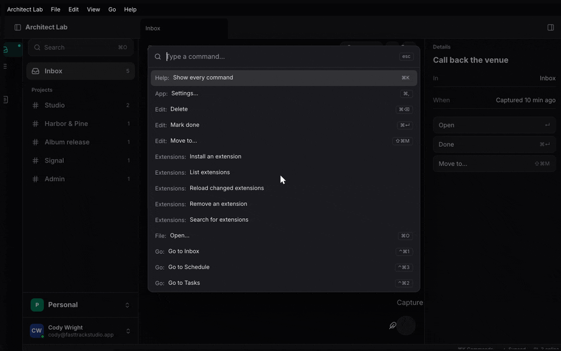
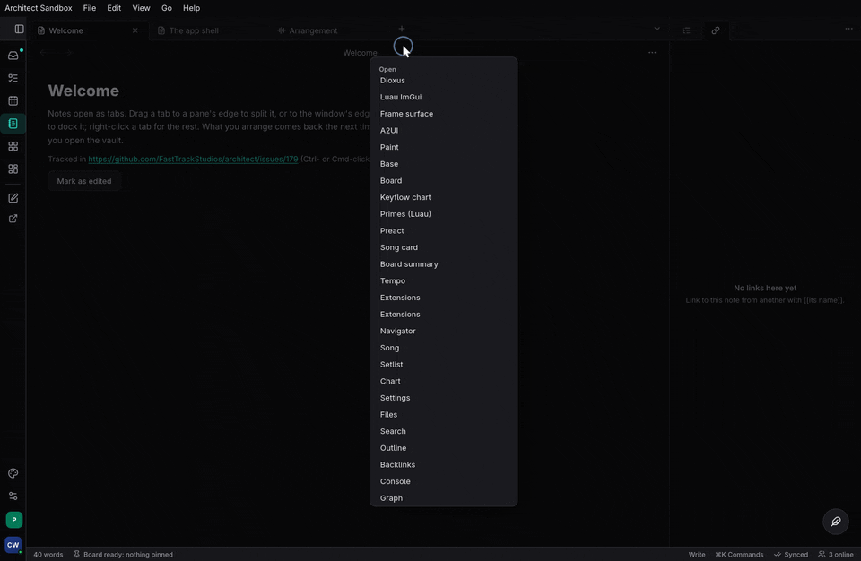
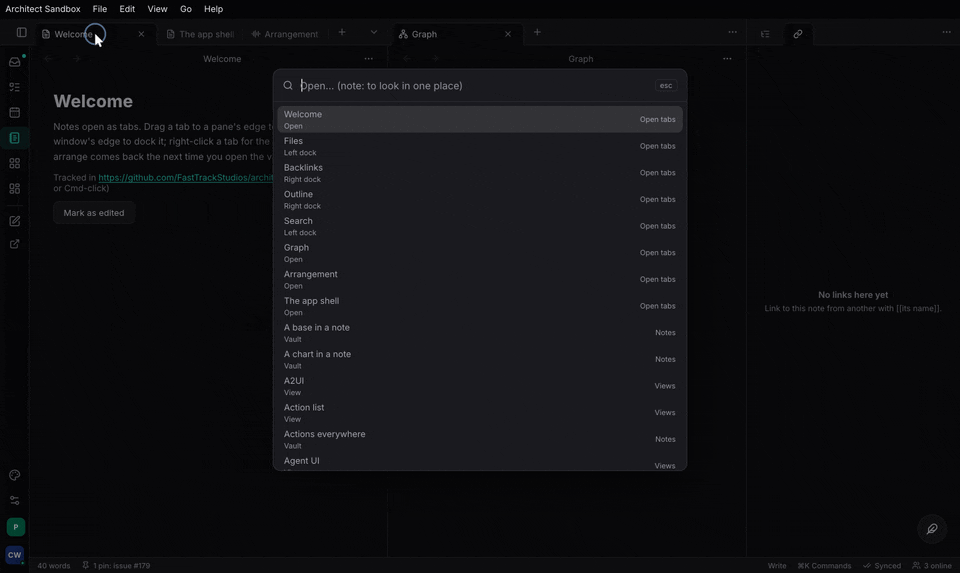

+++
title = "Commands and the Action List"
description = "One registry of everything a person or an agent can do: the ActionList, actions from a service, the ⌘K palette, ⌘O, the action list window, custom actions, and MCP."
weight = 41
+++

## What it is and when to use it

The `ActionList` is the app's registry of everything a person or an agent can
do. Each action has an id (`AREA_VERB`), an `Effect` (read-only, mutating or
destructive), facet `Args` and `Out` types with a schema, and a handler.
Keys, menus, the palette, scripts, a CLI and a model over MCP all run the
same id. `#[architect::service(actions)]` registers a whole service's
methods. `architect-commands` draws the ⌘K palette, ⌘O quick open, the action
list window (every command, searchable, with its group, shortcut and id, and
why one cannot run) and custom actions (steps a person chains). `architect-mcp`
serves the list to a model.

Use one action per capability; never a bespoke MCP tool, menu handler or
palette entry. Design: [The Action List](@/architecture/commands.md) and
[Actions everywhere](@/architecture/actions-everywhere.md).





## A minimal example

`architect` with `action-list`; `architect-mcp` with `http` (and `host` to
mount on `EngineHost`); `architect-commands` with `ui`. From
`examples/greeter/src/lib.rs` and `examples/greeter/tests/mcp.rs`:

```rust
#[architect::service(actions)]
pub trait Greeter {
    /// Greets a known name.
    async fn greet(&self, name: String) -> Result<String, GreetError>;
    /// How many greetings so far.
    #[action(effect = read_only)]
    async fn count(&self) -> Result<u32, GreetError>;
}

let list = ActionList::new();
greeter_actions::register(backend.clone(), &list)?;   // GREETER_GREET, GREETER_COUNT
list.validate()?;

let server = architect_mcp::Server::new("greeter", "0", list)
    .with_tools(architect_mcp::Tools::Named)
    .with_tool_name("GREETER_GREET", "greet");
if let Some(serving) = server.serve_loopback_or(47_811, "FTS_MCP_PORT", "FTS_MCP_TOKEN").await? {
    serving.publish("greeter")?;                       // so agents can find it
}
```

A hand-registered action, and the overlays in a Dioxus app (from
`features/commands/tests/keys.rs`):

```rust
static CLOSE: ActionMeta = ActionMeta {
    id: "WORKSPACE_CLOSE_TAB", trait_name: "", method_name: "", display_name: "Close tab",
    description: "", category: "", group: "Tabs", shortcut: "⌘W", toggleable: false, undo: false,
};
list.register(&CLOSE, Effect::Mutating, |(): ()| { close_tab(); Ok(()) })?;

let _ = use_commands_provider();
use_action_list(Arc::new(list));
rsx! { CommandLayer {} }          // ⌘K and ⌘O; ActionListView {} is the window
```

## Code tour

1. `crates/architect/src/action_list.rs` `ActionList`: `register`,
   `register_async`, `register_with` and `register_async_with` (the handler
   sees the `ActionCaller`), `register_dynamic`, `register_forwarded` (an
   action known only by its description, for extensions), `set_enabled`,
   `set_checked`, `validate`, `probe_hostile_args`, `changed`.
2. Same file, the doors: `run_json` (trusted; refuses an async action rather
   than block), `run_json_async`, `run_json_as`, `run_json_with`;
   `set_authorizer`, `infos_for`.
3. `crates/architect-rpc-derive/src/lib.rs` `service`: the `actions` option
   writes `<snake>_actions::register`.
4. `crates/architect-action-derive/src/lib.rs` `actions`: `#[architect::actions]`
   for a trait of named commands with menu metadata.
5. `features/mcp/src/lib.rs` `Server` (`with_tools`, `with_tool_name`,
   `handle_async`, `handle_as`, `tools_for`, `call_tool`), `Tools`.
6. `features/mcp/src/http.rs` `serve_loopback_or` (off with `FTS_MCP=0`),
   `Serving::publish`; `features/mcp/src/discovery.rs` `publish`,
   `project_mcp_json`; `features/mcp/src/host.rs` `McpHost`.
7. `features/commands/src/ui.rs` `use_commands_provider`, `use_action_list`,
   `use_command` (a view's own command), `use_opener`, `Commands::run`,
   `CommandLayer`, `ActionListView`.
8. `features/commands/src/palette.rs` `rank`, `features/commands/src/opener.rs`
   `Openers`, `features/commands/src/custom.rs` `CustomAction`.

A model's `tools/call greet` reaches `Server::handle_async`, which maps the
tool name to `GREETER_GREET` and runs it through `run_json_async_as`. Inside
the list: look the id up, authorize (callers other than the app itself),
check it is enabled, decode the arguments against the schema, run the
handler under a panic guard, and emit a `Ran` event. A palette or key run
goes through `Commands::run(id)` instead: view commands first, then the
Action Lists, then custom actions; an async action is spawned through
`run_json_async`.

## Tests to read

- `examples/greeter/tests/mcp.rs`: named MCP tools answer what HTTP answers.
- `examples/greeter/tests/host_mounts.rs`: MCP mounted on `EngineHost`.
- Unit tests in `crates/architect/src/action_list.rs` and `features/mcp/src/lib.rs`:
  registration, validation, the doors, tool modes, permission filtering.
- `crates/architect-action-derive/tests/smoke.rs`: derived actions.
- `features/commands/tests/commands.rs`: palette ranking, recents, openers,
  custom actions.

## Status

Done in architect. Limits: a service action's failure is the error's
`Display`; `service(actions)` handlers do not see the caller (a per-org
service registers by hand with `register_async_with`); MCP over HTTP runs as
the server's one principal; the router gate and the list's authorizer are two
planes. Not yet: keymap import and export, which-key's pause.

- **Task** registers its pilot tools by hand
  (`task:apps/server/src/actions/mod.rs`) and serves them with
  `Server::new(..).with_tools(Tools::Named)`; it does not use
  `architect-commands` yet.
- **Studio** uses the list and MCP (`studio:apps/session/daw/src/actions.rs`,
  `studio:apps/session/daw/src/mcp_server.rs`); the palette and action list
  window are still its own.
