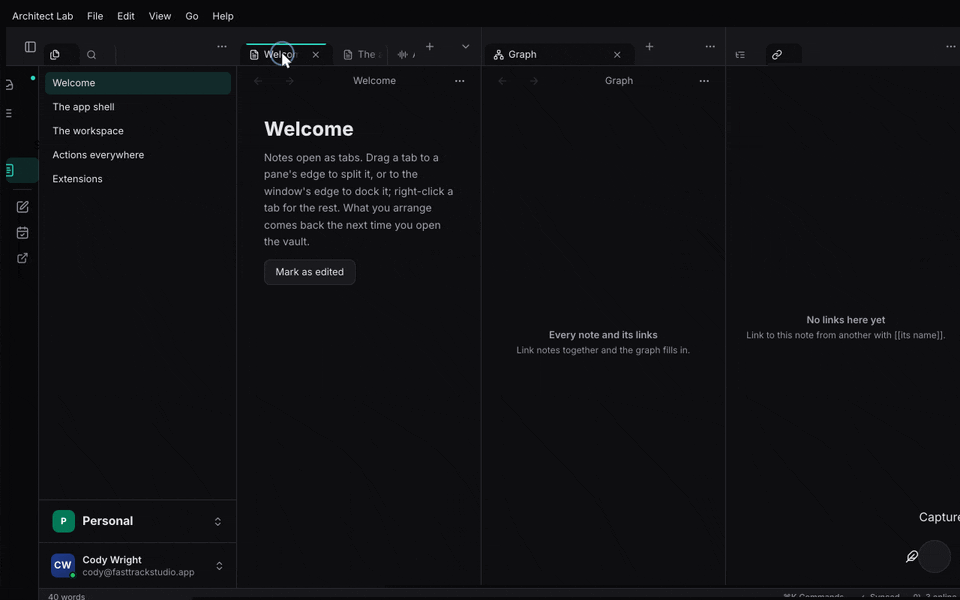

+++
title = "Menus"
description = "The menu bar declared over command ids: labels, shortcuts, enabled state and ticks from the commands, live sections, native on macOS, Linux and iPadOS, in the window elsewhere."
weight = 43
+++

## What it is and when to use it

`MenuBar` declares the app's menus (the app menu, File, Edit, View, …,
Window, Help) as lists of command ids. The labels, shortcuts, enabled or
disabled state with its reason, and ticks all come from the commands, so a
menu item never has a handler of its own: picking it runs the action. A live
section is a function read each time the bar is resolved (open windows, the
screensets). The same bar is drawn natively on macOS, through dbusmenu on
Linux, with `UIMenuBuilder` on iPadOS, and in the window where there is no
global menu.

Use it for every app's menu bar. Design: [App menus](@/architecture/app-menus.md).

<!-- media: menu-bar-view-menu — the View menu open: a ticked toggle, a disabled item with its shortcut, and the Screensets section with the current one ticked -->


## A minimal example

The model is in the default build of `architect-commands`; `ui` adds
`InWindowMenus`, `native` adds `NativeMenus`. From `apps/lab/ui/src/lib.rs`:

```rust
let menus = architect_commands::MenuBar::standard("Architect Lab")
    .menu("File", |m| m
        .commands(["LAB_CAPTURE", "LAB_OPEN_ANYTHING"])
        .separator()
        .command("WORKSPACE_CLOSE_TAB"))
    .menu("View", |m| m
        .command("LAB_TOGGLE_DETAILS")
        .separator()
        .section("Screensets", move || sets.read().menu_rows("VIEW_RECALL_SCREENSET")))
    .menu("Help", |m| m.command("LAB_SHOW_COMMANDS"));

rsx! {
    architect_commands::NativeMenus { bar: menus.clone() }   // macOS, Linux, iPadOS
    architect_commands::InWindowMenus { bar: menus }         // stands aside under a global menu
}
```

A toggle gets its tick from the list:
`list.set_checked("VIEW_MIXER", || mixer_open())?`. When what an enabled or
checked test reads changes outside an action run, call `list.changed(..)`, or
the bar keeps the old state.

## Code tour

1. `features/commands/src/menu.rs` `MenuBar`: `standard`, `menu` (a new menu
   goes before Window and Help), `resolve` against the commands there are.
2. Same file, `Menu`: `command`, `commands`, `group`, `separator`, `submenu`,
   `section`; `Live` rows (`args`, `checked`, `disabled`); `without_platform`.
3. Same file, `Tree`: the resolved bar numbered for a backend; `pick` says what
   a picked item runs.
4. `crates/architect/src/action_list.rs` `ActionList::set_checked`: a toggle's
   tick, carried to the command by `features/commands/src/ui.rs`.
5. `features/commands/src/native_menu.rs` `NativeMenus` (macOS),
   `features/commands/src/linux_menu.rs` with `features/commands/src/dbusmenu.rs`,
   and `features/commands/src/ios_menu.rs`: the same component per platform.
6. `features/commands/src/menu_view.rs` `InWindowMenus`; `Commands::has_global_menu`
   and `Commands::run_pick` in `features/commands/src/ui.rs`.
7. `features/workspace/src/screenset.rs` `Screensets::menu_rows`: the
   screensets as live rows, the current one ticked.

`NativeMenus` resolves the bar against `Commands::all()`: live sections run,
missing ids and stray separators drop out, and the result becomes a `Tree`
the platform backend draws. A pick comes back as a tree id; `Tree::pick`
turns it into a command and its arguments, and `Commands::run_pick` runs it
on the UI thread. The bar resolves again when the commands' event counter
moves (a run, `list.changed`, a registration) or a signal a section reads
changes, never on a timer.

## Tests to read

- `features/commands/tests/commands.rs`: a bar resolves against the commands
  there are; a new menu goes before Window and Help; a toggle resolves with its
  tick; a live section is read when the bar is resolved; platform items go
  without the platform; a tree numbers the bar and says what a pick runs.
- `features/workspace/tests/workspace.rs`: the View menu lists the screensets
  with the current one ticked.

## Status

Done in architect. The Linux and iPadOS bars build but have not been run on a
device. Open: the macOS About, Services and Hide items; a shortcut the menu
shows but the keymap does not bind.

- **Task** has no menu bar.
- **Studio** has its own (`studio:apps/signal/desktop/src/mac_menu.rs`, and
  Session's dbusmenu in `studio:apps/session/daw/src/app_menu/bus.rs`); both
  are to move onto `MenuBar`.
