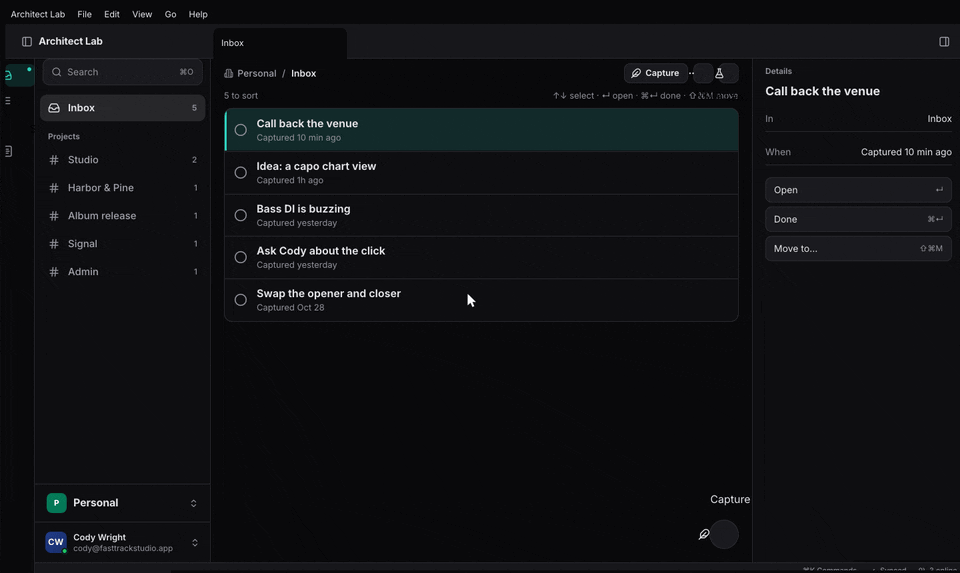

+++
title = "Organizations"
description = "architect-orgs: the person's organizations, the window's current one or All, roles and capabilities, the switcher, everything stored under the org, and servers confined to the caller's org."
weight = 32
+++

## What it is and when to use it

The organization is architect's concept, not each app's. One identity server
(fts-auth) owns orgs, members and roles. A window is in one org, or in All.
Every layer stores an org's data under `OrgId::path` (`org/<id>/…`), writes
only to the scope's write target, and reads All with `read_all`, where one
org failing hides none of the others. Roles map to the app's capabilities
(`notes.write`), with inheritance and per-org grants. On a server, an org
lane's scope (`Lane::new(router).scoped(org)` on an `EngineHost`, `confine`
elsewhere) puts each lane in one org, entered outside the gate, and `ConfinedEngine` refuses non-members and
resources under another org.

Use it for the org switcher, capability checks, All-organizations views and
server tenancy. Keep the org out of method arguments: it comes from the lane,
never from the caller. Design: [Organizations](@/architecture/organizations.md).



## A minimal example

The default build is the model and scope (wasm-clean); `auth` adds `fetch`;
`ui` the hooks and switcher; `commands` ⌘O across orgs; `server` confinement.
Client side, as in `apps/ui/src/lib.rs`:

```rust
let caps = Capabilities::new()
    .allow(&Role::Viewer, ["notes.read"])
    .allow(&Role::Member, ["notes.write"])
    .inherit();
let org = architect_orgs::use_orgs_provider(|| cached_orgs, caps, None);
use_orgs_live(org, conn, move |c| {
    let session = session.clone();
    async move {
        architect_orgs::fetch(&OrganizationServiceClient::new(c), &session)
            .await
            .map_err(|e| e.to_string())
    }
});
let workspaces = org.switcher(Some("All organizations"));
// In a feature: use_org() gives scope() and can("notes.write")
```

Server side, from `features/orgs/tests/host_lane.rs` and
`features/orgs/tests/server.rs`:

```rust
use architect::host::{EngineHost, Lane};
use architect_orgs::server::{ConfinedEngine, Members, MembersResolver, confine};

let members = Members::new();
let identity = MembersResolver::new(sessions, directory, members.clone());
let engine = ConfinedEngine::new(members.clone())
    .role(&Role::Member, vec![Rule::new("**", &["read", "write"])]);
let gate = PermissionsGate::new(Arc::new(engine), Arc::new(identity))
    .permit(notes_descriptor(), &PERMITS);
// On an EngineHost, /org/{slug}/vox: the host gates inside the lane's org.
EngineHost::new(router.clone(), gate, bind).vox_at("/org/{slug}/vox", move |head| {
    let router = router.clone();
    async move { Ok::<_, StatusCode>(Lane::new(router).scoped(org_of(&head)?)) }
});
// Or per connection on a transport of your own (only a gated handler fits):
let handler = confine(OrgId::new(slug), PermissionsGate::wrap_shared_with_bearer(gate, router, bearer));
// In a handler: current_org(); keys: org.path("notes/…")
```

`directory` is the identity server; `IdentityServer(orgs_client)` wraps an
`OrganizationService` client as one.

## Code tour

1. `features/orgs/src/model.rs` `Orgs` (`switch`, `refresh`, `can`),
   `Selection` (`One`, `All`), `Role`, `Capabilities` (`allow`, `inherit`,
   `grant`).
2. `features/orgs/src/scope.rs` `Scope` (`writes_to`, `is_all`),
   `OrgId::path`, `OrgId::doc_id`, `read_all` and `Aggregate`.
3. `features/orgs/src/auth.rs` `fetch`, `from_bundles`: the person's orgs from
   the identity server.
4. `features/orgs/src/refresh.rs` `Refresh`: one fetch per connection, the
   cache kept when it fails.
5. `features/orgs/src/ui.rs` `use_orgs_provider`, `use_orgs_live`, `use_org`,
   `OrgHandle` (`scope`, `stale`, `switcher`).
6. `features/orgs/src/opener.rs` `scoped_opener`: ⌘O across the scope; an item
   opens in the org it came from.
7. `features/orgs/src/server.rs` `confine`, `current_org`, `in_org`,
   `Members`, `MembersResolver`, `ConfinedEngine`, `MEMBERS_TTL`; the lane
   scope is `crates/architect/src/permissions_gate.rs` `LaneScope` and
   `crates/architect/src/host/mount.rs` `Lane`.

On the client, `use_orgs_live` fetches on every reconnect, and `Refresh`
either refreshes `Orgs` or keeps the cache and marks it stale. On the server,
a call on `/org/acme/vox` enters the lane's org (the `Lane` scope, or
`confine`), which sets the current org for the call, then the gate, which
checks it there. `MembersResolver` resolves the principal and, at most
once per `MEMBERS_TTL` per token, asks the directory for that session's orgs.
`ConfinedEngine` refuses a non-member of `current_org()` and any resource
under another org's path, then applies the role's rules inside the org.

## Tests to read

- `features/orgs/tests/orgs.rs`: selection, capabilities by role with
  inheritance, per-org grants, leaving the current org, the JSON cache.
- `features/orgs/tests/scope.rs`: window scope against All, paths and
  document ids, `read_all` with one org failing, `Refresh` per connection.
- `features/orgs/tests/opener.rs` (feature `commands`): ⌘O follows the org.
- `features/orgs/tests/server.rs` (feature `server`): a call runs in its lane's
  org and the role there decides; another org's resource is refused.
- `features/orgs/tests/host_lane.rs` (feature `server`): on an `EngineHost`
  org lane a member of another org is refused at the gate; an unscoped org
  lane fails closed under `ConfinedEngine::require_org`.
- `apps/auth-server/tests/surfaces.rs`: orgs fetched live on every transport;
  a confining server learning the caller's orgs from the identity server.

## Status

Done in architect, and already used by `architect-files`, the org sync driver,
settings (`OrgSettings`) and extensions (an org's approved list). Not yet:
presence by org. Membership changes reach a server within `MEMBERS_TTL`.
A lane's org alone refuses no one; the engine must be (or include)
`ConfinedEngine`. A gate with no All-organizations lane sets
`ConfinedEngine::require_org`, so a lane left unscoped is refused.

- **Task** keeps its own org selection (`task:crates/ui-core/src/orgs.rs`); to
  adopt: `architect-orgs` on the client and `confine` on the server.
- **Studio** does not use it yet.
