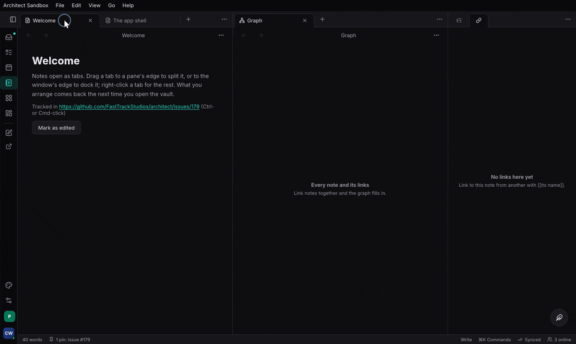
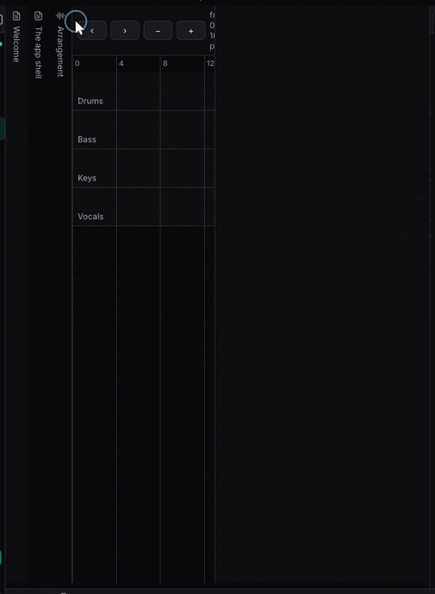
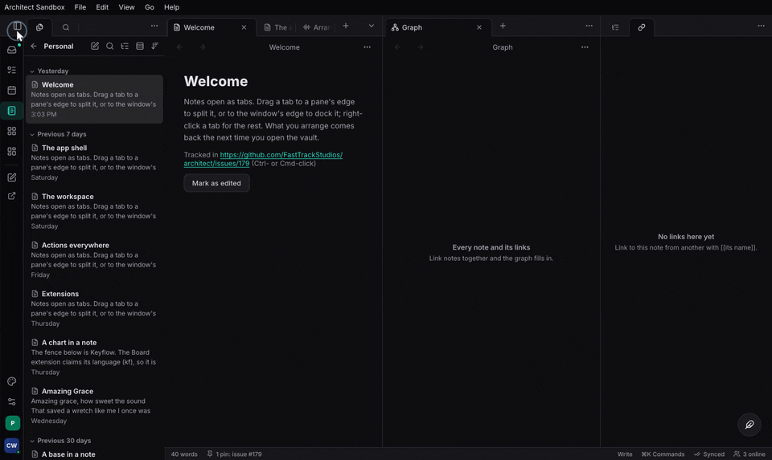
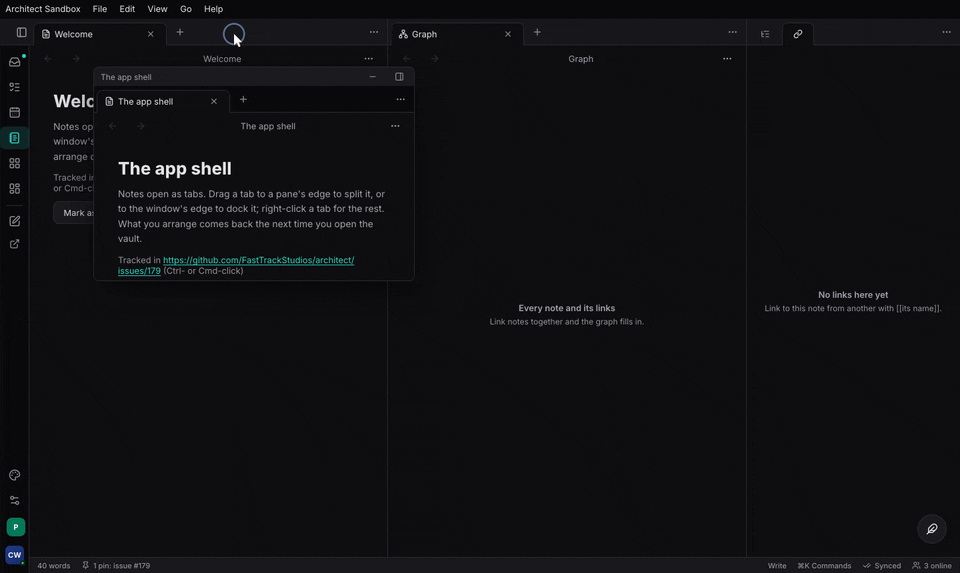
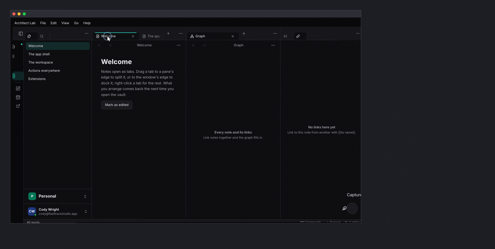
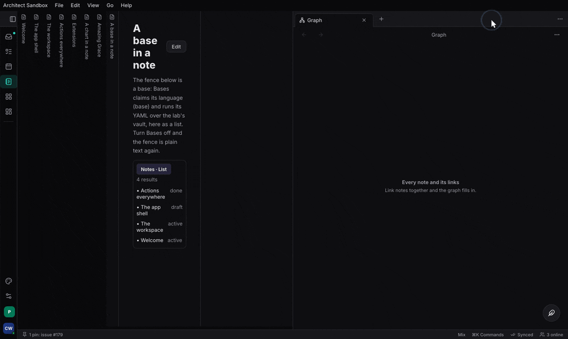

+++
title = "Workspace and shell"
description = "architect-workspace: tab groups in splits, docks, stacked tabs, floats, pop-out OS windows, stable pane ids and screensets; architect-shell: the app's frame on desk, tablet and phone."
weight = 44
+++

## What it is and when to use it

`architect-workspace` is the layout an app's views live in, in the manner of
Obsidian and REAPER: tab groups in splits, docks on each side with ribbons,
stacked tabs that slide over each other, floating panes, pop-out tabs as
real OS windows, and screensets (named layouts recalled with ⌘1–9, kept per
form factor). Panes have stable ids, so opening something already open
brings it forward. The model is plain data, and every operation ends in
`Workspace::repair`, so a layout is always valid. The app gives `Views` (a
kind, a title, how to draw it) and gets the whole workspace; it never lays
out panes.

`architect-shell` is the frame around it: tabs as a rail, a sidebar or a
floating pill (with a separate button), drawers, the macOS title bar,
breadcrumbs and toolbars, the org and workspace switcher, the account, the
status line. Develop both in the sandbox, `apps/sandbox` (`dx serve`). Design:
[Workspace](@/architecture/workspace.md), [App shell](@/architecture/app-shell.md)
and [Composing the UI](@/architecture/composing-the-ui.md).







<!-- media: shell-form-factors — the same app as a desk window (title-row tabs, ribbon, sidebar, status bar), on a tablet, and on a phone (floating tab pill, drawer) -->

## A minimal example

The model is in the default build (wasm-clean); `ui` is the Blitz host;
`native` the desk launcher with pop-out windows. Model, from
`features/workspace/tests/workspace.rs`:

```rust
use architect_workspace::{Pane, Side, Target, Workspace};

let mut ws = Workspace::new();
ws.open(Pane::new("note-1", "note", "Welcome"), Target::Tab)?;
ws.open(Pane::new("files", "files", "Files"), Target::Dock(Side::Left))?;
```

Host, after `apps/ui/src/vault.rs` `VaultPage` (which passes more props):

```rust
use architect_workspace::{MemoryStore, Screenset, Screensets, FormClass, Side, Target,
                          View, Views, WorkspaceStore, WorkspaceView};

#[component]
fn Vault() -> Element {
    let workspace = use_signal(first_workspace);
    let sets = use_signal(|| Screensets::default().with_builtins([
        Screenset::new("Write").slot(1).layout(FormClass::Desk, first_workspace()),
    ]));
    let views = use_hook(|| Views::new()
        .view(View::new("note", "Untitled", |pane| rsx! { NoteView { pane } }).many())
        .view(View::new("files", "Files", |_| rsx! { FilesView {} }).home(Target::Dock(Side::Left))));
    let store = use_hook(|| WorkspaceStore::new(MemoryStore::new()));
    rsx! { WorkspaceView { workspace, views, screensets: sets, store } }
}

// A desk app's main: architect_workspace::native::launch(App, window_attributes);
```

The frame is `AppShell { screen, tabs, current, on_tab, .. }` at the app's
root, with the page as its children; a page adds status items with
`use_status` and claims the sidebar with `use_shell_slots`.

## Code tour

1. `features/workspace/src/model.rs` `Workspace`, `Pane`, `PaneId`, `Group`,
   `Node`: the layout as data.
2. `features/workspace/src/ops.rs` `Target`, `Dest`, `Workspace::open`,
   `Workspace::close_window`, `Workspace::to_main_window`; and
   `features/workspace/src/repair.rs` `Workspace::repair`.
3. `features/workspace/src/screenset.rs` `Screensets` (`with_builtins`,
   `recall`, `recall_slot`, `save`, `save_named`, `rename`, `set_slot`,
   `is_dirty`, `menu_rows`, `options`), `FormClass`;
   `features/workspace/src/store.rs` `Store`, `MemoryStore`, `load_split` /
   `save_split` (the saved sets where they are shared, the working copy on
   the device).
4. Saved layouts, the person's "workspaces" (Obsidian's Workspaces plugin):
   `WORKSPACES_LIST`, `WORKSPACES_LOAD {id|name|slot}`,
   `WORKSPACES_SAVE {name?}` (no name: the active set; a name: over the set
   of that name, or a new one), `WORKSPACES_RENAME {id, name}`,
   `WORKSPACES_SET_SLOT {id, slot?}`, `WORKSPACES_OPTIONS {save_before_load?,
   slot_keys?}`, `WORKSPACES_RESET`, and `WORKSPACES_DELETE {id}`
   (destructive, so an agent gets a confirmation ticket), in
   `features/workspace/src/control/write.rs`. Each change of the saved sets
   is a `Changed { topic: "workspaces" }` event. `WORKSPACES_MANAGE` opens
   the sheet (`features/workspace/src/host/manage.rs` `ManageSheet`): every
   set with Load, Save over, Rename, its ⌘ key, Delete, Reset, and a field
   to save the current layout under a name. The palette lists "Load
   workspace: <name>" for every set. `WorkspaceView`'s `sets_noun` names
   them per app ("Workspace" by default; Studio's "Screenset").
5. `features/workspace/src/drop.rs` `drop_in`, `Bar` and
   `features/workspace/src/layout.rs` `area_rects`, `neighbour`, `slides`:
   where a dragged tab lands; stacked tabs sliding.
6. `features/workspace/src/host/mod.rs` `WorkspaceView`, `View`, `Views`,
   `use_pane`, `use_pane_status`, `TitleRow`; `features/workspace/src/host/commands.rs`
   registers the `WORKSPACE_*` commands.
7. `features/workspace/src/host/windows.rs` `WindowSystem`, `Popout`, `Bridge`
   and `features/workspace/src/native.rs` `launch`, `launch_with_fonts`.
8. `features/shell/src/shell/mod.rs` `AppShell`, `Tab`, `Action`, `Account`,
   `WindowChrome`, `use_shell_slots`; `features/shell/src/shell/page.rs` `Page`,
   `Toolbar`, `Breadcrumb`; `features/shell/src/shell/status.rs` `StatusItem`,
   `use_status`; `features/shell/src/screen.rs` `Screen`, `FormFactor`.

A tab drag in `WorkspaceView` hit-tests the groups and bars with `drop_in`,
then moves the pane on the shared `Signal<Workspace>`; `repair` restores the
invariants, and the settled layout is written to the current screenset and
the app's store. Dragged out of the window, the `native` launcher's
`WindowSystem` opens a `Popout`: a second Dioxus document reading the same
signal, with the `Bridge` contexts carried into it. Closing that window gives
its tabs back to the main one.

## Tests to read

- `features/workspace/tests/workspace.rs`: every operation and invariant,
  docks, floats, windows, history, screensets, the store round trip, drops,
  sliding stacked tabs.
- `features/workspace/tests/actions.rs`: every workspace action over MCP,
  the saved layouts (saved over by name, renamed, slotted, deleted, with
  their options and events), a set bringing back pop-out windows, dock
  sizes and visibility, floats and pinned tabs, and the split store.
- `apps/sandbox/scenarios/workspaces-manage.styx`: the manage sheet, played.
- `features/workspace/tests/windows.rs`: one document's signal redraws
  another; a pop-out opens and gives its tabs back; a kept layout comes back
  on mount; a pane's status items.
- `features/workspace/tests/popout_theme.rs`: a pop-out follows every theme
  change after it opens: its chrome (the host's `ShellTheme`, a signal it
  shares with the main window) and the theme's CSS variables (the main
  window's `:root` sheet, `architect_theme::RootCss`, set on the pop-out's
  root element).
- `features/workspace/tests/inner_html.rs`: a window's document
  (`native::document_config`, the main window's and every pop-out's) parses
  `dangerous_inner_html` into nodes.
- The shell has unit tests for form factors and frames only; it is checked by
  eye in the sandbox, `apps/sandbox`.

## Status

Done in architect. Not yet: dragging a tab onto a group in another window;
docks in pop-outs; the app's chords inside a pop-out; saved layouts kept in
an org's scope as team layouts. Every workspace operation is an Action List
action (`docs/content/architecture/workspace.md`). An app keeps the saved
sets in its settings scope of choice by passing a `store` over it (and a
`device_store` for the working copy). Blitz differences found building these are in
`skills/architect/references/blitz-quirks.md`.

- **Task** has its own shell (`task:crates/ui/src/shell/app_shell.rs`, the
  design reference for `architect-shell`); to adopt both crates.
- **Studio** has its own dock (`studio:features/ui/dock`, the starting point
  for the workspace); to adopt both crates.
