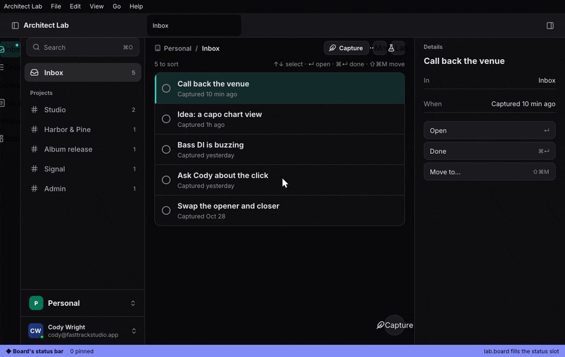

+++
title = "The Architect tour"
description = "A guided tour of every system, in the lab: one chapter each, over the live app, built from a guide scenario."
weight = 15
+++

The lab (`apps/lab`) is a made-up app assembled from architect's parts.
Its tour walks through every system the framework has, one chapter at a
time, over the running app: each chapter moves the app to the right
place, rings the control it is about, and says in a few lines what it is,
why it matters and the one thing to try. Nothing in the lab is anyone's
real data, so every control is live.

```sh
devenv up    # the lab under dx serve, plus Teley and its collector
just lab     # or the lab alone, without dx
```

The tour starts on the lab's first launch. After that, ⌘K › **Take the
tour** goes on where you stopped (or from the start, once you finished
it); Next and Back move between chapters, Skip leaves. An agent starts it
like anything else, over the Action List:
`architect-desktop actions run GUIDE_TOUR_START --arg id=architect-tour`.



## The chapters

| Chapter | What it shows | Where to read more |
|---|---|---|
| Welcome | how the tour moves | this page |
| The shell | tabs in the title row, a page's sidebar default and the rail, phone, tablet and desk | [App shell](@/architecture/app-shell.md) |
| The workspace | splits, stacked tabs, docks, floats, pop-out windows, screensets, layouts as files | [Workspace](@/architecture/workspace.md), [Interface files](@/architecture/interface-files.md) |
| Runtime theming | `THEME_SET`, light and dark pairs, theme files read on save, `$ref` and `mix(…)` tokens, the magenta fallback, layers | [Theming](@/architecture/theming.md) |
| The Action List | one list behind ⌘K, menus, keys, the CLI, MCP and the control socket | [Actions everywhere](@/architecture/actions-everywhere.md) |
| Agents | `APP_STATUS`, `APP_SHOT`, layouts and `keys.json` as files with a `.error` beside a bad save, clone-to-edit | [CLI and MCP](@/guide/cli-and-mcp.md), [Interface files](@/architecture/interface-files.md) |
| Extensions | the manager, the runners, `EXT_CLONE` and the way back, signed `.archext` archives | [Extensions](@/architecture/extensions.md) |
| Contributions | tabs, openers, status, menus, context menus, the phone bar, hooks, slots, sections | [Extensions](@/architecture/extensions.md) |
| Inline embeds | a fenced block drawn by an extension inside a note | [Extensions](@/architecture/extensions.md) |
| Workers and budgets | primes counted in a worker, a slow view kept on its last frame and marked busy | [Extensions](@/architecture/extensions.md) |
| Settings | the settings window as a built-in extension, sections arriving through a contribution point | [Settings page](@/architecture/settings-page.md) |
| Pages | TSX, Luau and A2UI pages, live on save, the `.error` loop | [Pages](@/architecture/pages.md) |
| Embedded views | Dioxus, Luau ImGui, a Frame surface, A2UI, the GPU `paint` view, CRDT documents | [Embedded views](@/architecture/embedded-views.md) |

What the lab cannot show, the chapter says: the Clicker (a process over
vox) and the WASI counter need their programs built beside the lab (WASI
with `--features wasi`), Keyflow's editor and chart need `--features
keyflow-lab`, the lab ships no `.archext` archive, and no lab extension
declares a service for another to use.

## How it is built

The tour is one guide scenario, `apps/lab/scenarios/architect-tour.styx`,
played live by `architect-guide`'s tour (`features/guide/src/tour.rs`;
[Guide media](@/architecture/guide-media.md)). A chapter is its setup,
hidden steps that run Action List actions (`LAB_GO`, `WORKSPACES_LOAD`,
`APP_SETTINGS`, `MANAGER_SHOW`, `EXT_VIEW_OPEN`), and one step with the
text and the target to ring. Each chapter's setup puts the whole app where
it needs it, because the tour runs it again on Back
(`features/guide/src/tour.rs` `setup_of`) and when it resumes at a step
(`GUIDE_TOUR_START {id, step}`, `Tours::start_at`).

The lab remembers the place through `TourSet::on_move`
(`apps/lab/ui/src/guide.rs` `tours`): every chapter shown is written to
`tour-place` in the lab's folder, and `done` once the last one is.

`apps/lab/media/tests/tour.rs` plays it as a person would, started from
the Action List and moved on with Next, and checks that every chapter
comes up with its target on screen; it also resumes it at a chapter and
goes Back. The scenario itself runs in `just media-test` with the others.
