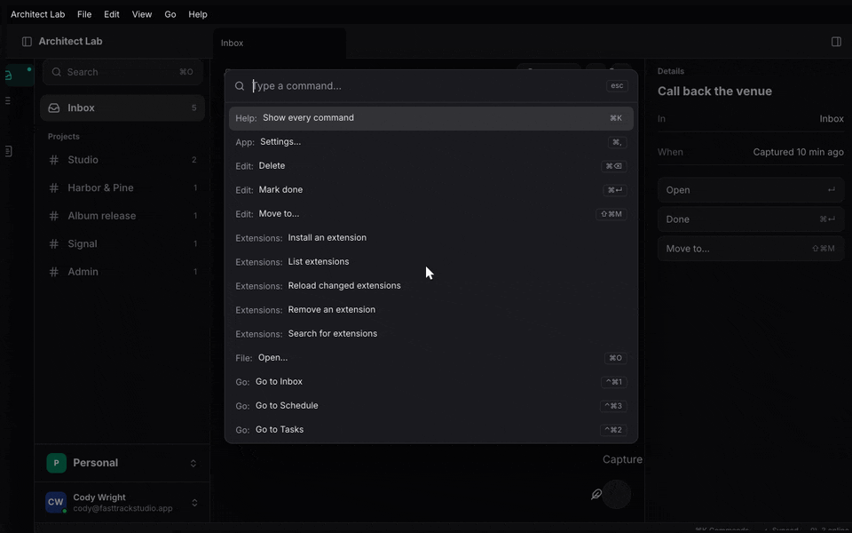
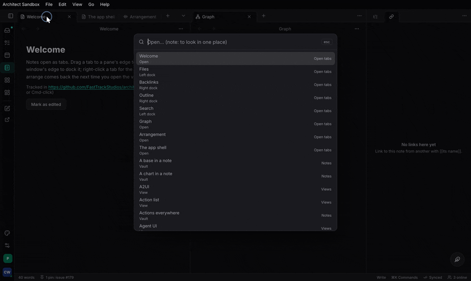
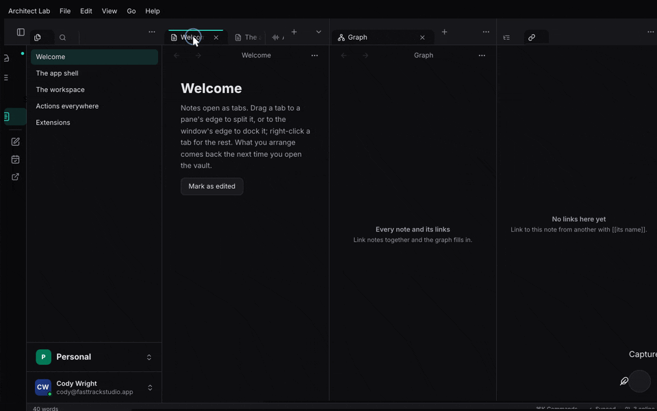

+++
title = "Commands, keys and menus"
description = "Put everything the app does on the Action List once, and get the ⌘K palette, ⌘O, the action list window and its binding editor, keys through architect-input, native and in-window menus, and MCP from it."
weight = 90
+++

In an architect app, everything the program can do is an **action** on its
Action List, with an id. A menu item, a key, the ⌘K palette, a script and a
model over MCP all run the same action by that id; none of them holds a
handler of its own. In this chapter you will:

1. register actions on an `ActionList`, and commands a view owns while it is
   mounted;
2. mount the commands layer: ⌘K, ⌘O and the action list window with its
   binding editor;
3. bind keys, sequences, held-letter tools and MIDI/OSC through
   `architect-input`, with the person's layer over the app's keymap;
4. build the menu bar from the same commands: native on macOS, Linux and
   iPad, in the window elsewhere;
5. serve the list to a model over MCP.

The sandbox wires all of it: `apps/ui/src/lib.rs` `LabApp`.

## 1. Actions

The Action List is `architect::action` (`crates/architect/src/action_list.rs`,
architect's `action-list` feature). An action is an `ActionMeta` (its id,
label, description, group, display shortcut), an `Effect` (read-only,
mutating, destructive), and a handler that takes facet arguments:

```rust
use architect::action::{ActionList, ActionMeta, Effect};

let list = ActionList::new();
list.register(&HITS, Effect::ReadOnly, |q: Query| {
    Ok(Hits { times: hits(&q.track, q.limit.unwrap_or(10)) })
})?;
list.register_async(&ASK, Effect::ReadOnly, move |q: Ask| {
    let client = client.clone();
    async move { client.ask(q.name).await.map_err(|e| e.to_string()) }
})?;
```

- **Ids are the contract.** `AREA_VERB` in SCREAMING_SNAKE (`TRACKS_ARM`).
  Keymaps, menus and saved scripts store the id, so never rename one.
- **Enabled and ticked.** `list.set_enabled(id, || Err("nothing selected".into()))`
  disables an action with its reason; `list.set_checked(id, || on)` makes it
  a toggle that every menu ticks.
- **Many at once.** `#[architect::actions(namespace = "SESSION")]` on a trait
  of `&self` methods registers each as an action;
  `#[architect::service(actions)]` projects every method of a service onto
  the list (`<NS>_<METHOD>`).
- **Check it in a test.** `list.validate()` reports duplicate ids, bad id
  shapes, duplicate shortcuts and malformed schemas.

The full API (callers, contexts, async doors, watching) is the
[Action List page](@/architecture/commands.md); this chapter is about what
the UI does with it.

### A view's own commands

Some commands exist only while a view is on screen: "Mark done" on a list,
"Open the selected item". A view registers them with `use_command`
(`features/commands/src/ui.rs`); they are in the palette, run by their
shortcut, and gone when the view unmounts. From the sandbox:

```rust
architect_commands::use_command(
    architect_commands::Command::new("LAB_CAPTURE", "Capture")
        .group("Inbox")
        .shortcut("⇧⌘N"),
    move || lab.capture("inbox"),
);
architect_commands::use_command(
    architect_commands::Command::new("LAB_TOGGLE_DETAILS", "Details")
        .group("View")
        .checked((lab.right)()),          // a toggle: ticked in every menu
    move || lab.put_bool("workspace.details", !(lab.right)()),
);
architect_commands::use_command(
    if undone.is_some() { undo } else { undo.disabled("nothing has been completed or deleted") },
    move || lab.undo(),
);
```

Call it on every render: the label, shortcut, enabled and checked state are
kept current; the handler is the first one given.

## 2. The commands layer: ⌘K, ⌘O, the action list window

At the root, put a `Commands` in context, hand it the app's Action List, and
mount the overlay layer:

```rust
let commands = architect_commands::use_commands_provider();
architect_commands::use_action_list(list.clone());   // every action is a command
rsx! {
    architect_commands::WindowKeys {}                  // desk: hear the window's chords
    AppShell { /* … */ }
    architect_commands::CommandLayer {}                // the palette and quick open
}
```

`WindowKeys` (`features/commands/src/native.rs`, feature `native`) matters
in Blitz: keys reach the DOM only through what has focus, so a chord must be
heard at the window to work after a click on empty space.

What you get:

- **⌘K, the palette** (`CommandPalette`): every enabled command, the most
  specific first, recent first when the field is empty, disabled ones dimmed
  with why. An action with arguments asks for them a step at a time from its
  params schema (`features/commands/src/params.rs`). Prefixes narrow it:
  `@` this page's targets, `#` settings, `?` help for a key. Open it with
  `commands.show(Overlay::Palette)`.



- **⌘O, quick open** (`QuickOpen`): every opener at once. A feature
  registers one with `use_opener`; the sandbox's Vault registers its notes and
  opens the picked one where the person asked (here, a new tab, a split):

  ```rust
  architect_commands::use_opener(move || {
      architect_commands::Opener::new(
          "note",
          "Notes",
          |_| NOTES.iter().map(|(id, title)| OpenItem::new("note", *id, *title).detail("Vault")).collect(),
          move |item, open_in| {
              let target = match open_in {
                  OpenIn::Here => Target::Here,
                  OpenIn::Tab => Target::Tab,
                  OpenIn::Split => Target::Split(Side::Right),
              };
              let _ = workspace.write().open(note(&item.id, &item.title), target);
          },
      )
  });
  ```

  `use_palette_opener(Scope::Targets, …)` fills the palette's `@` the same
  way; the settings page registers `#` itself.



- **The action list window** (`ActionListView`): REAPER's. Every action,
  searchable by name, id, group and binding; for each its bindings by
  context, with the **binding editor** (`BindingEditor`: press the chord to
  record it, conflicts shown, reset to the app's default) and custom actions
  with conditions (`KeymapTools`). It is an ordinary component, so the sandbox
  makes it a workspace view:

  ```rust
  View::new("actions", "Action list", |_| rsx! { architect_commands::ActionListView {} })
  ```

<!-- media: action-list-binding-editor — the action list window: an action searched, a new chord recorded, a conflict shown -->

## 3. Keys through `architect-input`

`architect-input` (`features/input`) is the keymap engine: chords, a key
trie, modes, contexts, sequences, which-key, mouse and wheel tables, MIDI
and OSC. A binding maps keys to an action id; it holds no handler.

### The keymap

A keymap is JSON. Bindings can belong to a context (where they apply), and a
context's bindings beat the mode's own, innermost first:

```json
{
  "keymap": { "normal": { "Ctrl+d": "EDIT_DUPLICATE", "g g": "CURSOR_TOP" } },
  "contexts": {
    "session.arrange": {
      "keys": { "Ctrl+d": "ARRANGE_DUPLICATE" },
      "mouse": { "Z+Left.Drag": "VIEW_ZOOM_BOX" },
      "scroll": { "Z+Scroll": "VIEW_ZOOM" }
    }
  },
  "midi": { "CC64 ch1": "TRANSPORT_PLAY", "Note60": "MARKER_ADD" },
  "osc": { "/transport/play": "TRANSPORT_PLAY" }
}
```

- **Sequences** (`g g`) wait for the next key; while one is pending,
  `WhichKeyPanel` shows what can follow, with each entry's label.

<!-- media: which-key-panel — a key sequence pending, the which-key panel listing what can follow -->

- **Held-letter tools.** A key a pointer or wheel pattern names as held
  (`Z+Left.Drag`) is a modifier while it is down: its press shows the tool's
  gestures and runs nothing, and a release with nothing in between is a tap
  that runs what the key is bound to.

<!-- media: held-letter-zoom-tool — Z held over the arrangement: the tool's gestures shown, a drag zooming to a box -->

- **MIDI and OSC** bindings are matched here; the sources are the app's: it
  hands each message in as `InputEvent::Midi` / `InputEvent::Osc` through
  `commands.handle_input(event)`.

### The person's layer

Give the commands layer the app's keymap and the person's changes over it
(`features/commands/src/keys_ui.rs` `use_keymap`):

```rust
// `app_keymap`, `load_layer` and `keep_layer` are yours.
architect_commands::use_keymap(
    app_keymap,                                   // fn() -> KeymapConfig, the shipped bindings
    load_layer,                                   // fn() -> PersonKeymap, the person's changes
    Some(Callback::new(move |layer: PersonKeymap| keep_layer(layer))),
);
```

The `on_change` callback is where you keep the person's layer, in their
synced settings so their keys follow them; when it changes on another
device, hand it back with `Commands::set_person_keymap`. The binding editor
writes to this layer, never to the app's.

### Contexts

Say which contexts are live as focus moves: `commands.set_context("session.arrange.item")`
makes `session`, `session.arrange` and `session.arrange.item` live
(`set_contexts` for names that do not nest by dots).

### Keep the keymap and the list in step

A key bound to an id the list does not have does nothing. Test every
binding names an action, the way `docs/content/architecture/input.md`
("Keep the keymap and the list in step") does.

## 4. Menus

The menu bar is a view of the commands (`features/commands/src/menu.rs`
`MenuBar`): you say which commands go in which menu; the labels, shortcuts,
enabled state and ticks come from the commands. From the sandbox:

```rust
let menus = architect_commands::MenuBar::standard("Architect Lab")
    .menu("File", |m| {
        m.commands(["LAB_CAPTURE", "COMMAND_PALETTE_OPEN_ANYTHING"])
            .separator()
            .commands(["WORKSPACE_CLOSE_TAB", "WORKSPACE_REOPEN_TAB"])
    })
    .menu("View", |m| m.command("LAB_TOGGLE_DETAILS").separator().group("Panes"))
    .menu("Go", |m| {
        // A live section: read again whenever the bar is resolved.
        m.section("Tabs", move || {
            let on = (lab.route)().tab();
            TABS.iter()
                .map(|(id, label, to)| architect_commands::Live::new(*label, *id).checked(*to == on))
                .collect()
        })
    })
    .menu("Help", |m| m.command("COMMAND_PALETTE_OPEN"));
```

- `MenuBar::standard` lays out the app menu, File, Edit, View, Window and
  Help with the platform's own items (Undo, Copy, Minimize, Quit…), wired
  to the focused view; `menu(name, …)` fills one (a new name goes before
  Window).
- `group("Panes")` is every command in that group, by label.
- `section(name, rows)` is live: `Live` rows (a label, the command, its
  arguments, ticked or not), computed each time the bar is resolved. The
  workspace's `Screensets::menu_rows` is one, for a View ▸ Screensets menu.
- A bar resolves again when the lists' events move on (every run, every
  registration, every `list.changed(…)`) and when a signal a section reads
  changes. If you change what a `checked` reads outside an action, call
  `list.changed(topic, detail)`.

Draw it with both components; the in-window one stands aside where the
platform shows the bar (`apps/ui/src/lib.rs` `NativeMenus`):

```rust
#[cfg(any(target_os = "macos", target_os = "linux", target_os = "ios"))]
rsx! {
    architect_commands::NativeMenus { bar: menus.clone() }   // AppKit, dbusmenu, UIMenuBuilder
    architect_commands::InWindowMenus { bar: menus }
}
```

| Platform | Bar |
|---|---|
| macOS | the native menu bar (`features/commands/src/native_menu.rs`, through `muda`) |
| Linux | exported as dbusmenu to a global menu (`features/commands/src/linux_menu.rs`); the in-window bar when no registrar takes it |
| iPad with a keyboard | the iPadOS menu bar (`features/commands/src/ios_menu.rs`) |
| Windows, other Linux | `InWindowMenus`, in the shell's theme |
| Phone | none: the palette and each page's ⋯ |

The Linux and iPad bars are checked to build, not yet run on a device.

<!-- media: menu-bar-native-macos — the macOS menu bar built from the sandbox's MenuBar: a ticked Details toggle and the live Tabs section -->


## 5. MCP

A model reaches the same list over MCP (`features/mcp`):

```rust
let server = architect_mcp::Server::new("session", env!("CARGO_PKG_VERSION"), list.clone())
    .with_tools(architect_mcp::Tools::Named);           // one tool per action; Generic by default
if let Some(serving) = server.serve_loopback_or(47_811, "FTS_MCP_PORT", "FTS_MCP_TOKEN").await? {
    serving.publish("session")?;                         // <config>/fts/session-mcp.json, 0600
}
```

Generic tools are `actions`, `describe`, `run`, `batch` and `watch`; named
tools are one per action with its params schema. A model runs as a
principal, so give the list the same permission engine as your router's
gate (`list.set_authorizer`): the app's own doors (keys, menus) skip the
authorizer by design, a model's do not. Bind loopback and set a token for
any app with destructive actions.

The same list is on the command line, with the same answers:
[CLI and MCP](@/guide/cli-and-mcp.md).

## Where Task and Studio are

The palette, quick open, the action list window, bindings and menus are
architect-side. Studio's library ⌘K/⌘O and Task's quick switcher become
openers when they move; Studio's AppKit menu and Session's dbusmenu tree
become `MenuBar` declarations. REAPER's `reaper-kb.ini` import, keymap
import/export UI and which-key's pause are still to come.

## Where to read more

- [The Action List and MCP](@/architecture/commands.md): registering,
  callers, async actions, MCP tools and transports.
- [Actions everywhere](@/architecture/actions-everywhere.md): the palette,
  ⌘O, the action list window, custom actions.
- [Keymaps](@/architecture/input.md): the keymap format, contexts,
  held-letter tools, user keymaps, which-key.
- [App menus](@/architecture/app-menus.md): the model, live sections, each
  platform's bar.
- `skills/architect/references/commands-mcp.md`.
