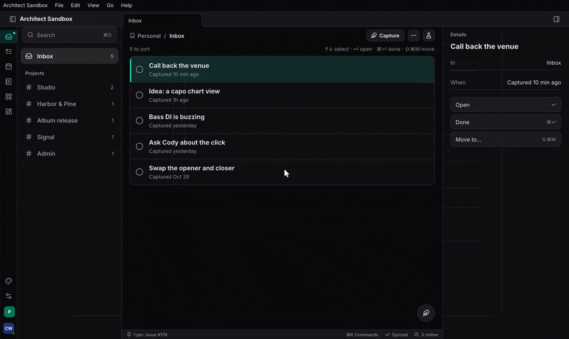
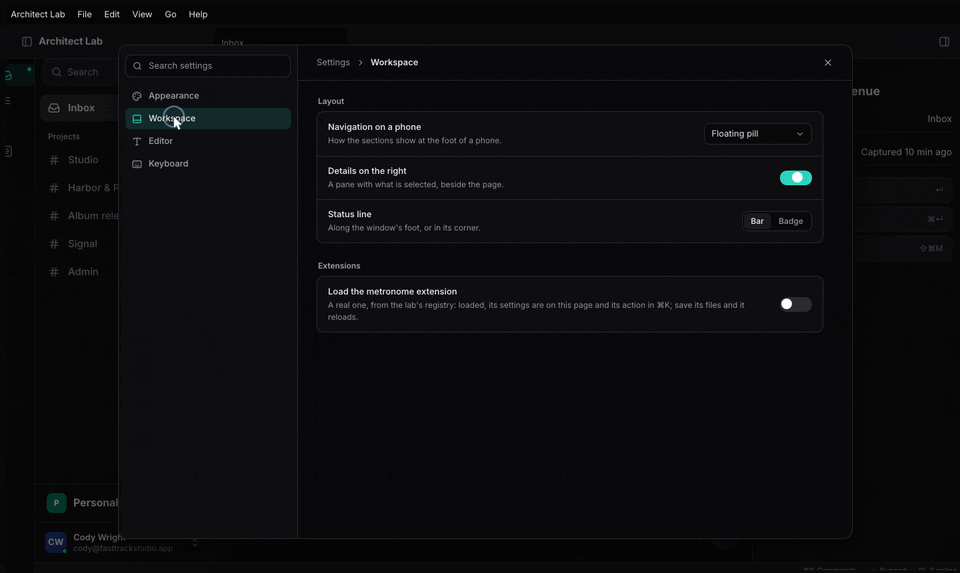

+++
title = "Settings"
description = "Declare settings once as a typed struct; architect stores each in its scope (this device, the person's, the project's) under an org's defaults and locks, and draws the settings page with search to the row."
weight = 100
+++

An app declares its settings once, as structs. The store, the settings
page, its search, the reset arrows and "Restore defaults" all come from
the declaration. In this chapter you will:

1. declare a section with `#[derive(Settings)]`;
2. read and change it with `use_settings::<T>()`, and outside the UI with
   `T::read`;
3. choose each section's scope and keep each scope's values where they
   belong: the device, the person's synced document, the project;
4. apply an organization's defaults and locks;
5. mount the settings page, opened by ⌘, and found from ⌘K's `#`.

Everything here is `architect-settings` (`features/settings`). The default
build is the model (wasm-clean); feature `store` keeps device and project
values on disk, `synced` keeps the person's in a CRDT document, `ui` draws
the page and gives the hooks. The sandbox registers four sections
(`apps/ui/src/settings.rs`); the derive's full behaviour is pinned by
`features/settings/tests/derive.rs`.

Device-only key/value storage without a page is architect's own
`architect::settings::Store<T>`
([app settings](@/architecture/settings.md)); this chapter is the layer
above it.

## 1. Declare a section

A facet struct with `Default` becomes a section. The doc comments are the
words, the types are the controls, `Default` is the defaults:

```rust
use architect_settings::Settings;
use facet::Facet;

/// Editor
#[derive(Facet, Settings, Clone, PartialEq)]
#[settings(icon = "type")]
pub struct Editor {
    /// Vim keys
    /// Move and edit with Vim's keys.
    #[setting(aliases = ["modal", "hjkl"])]
    pub vim: bool,
    /// Line width
    /// How wide a line of a note runs.
    #[setting(control = slider(40..=120, step = 1), unit = " ch")]
    pub width: f64,
    /// A new note's title
    #[setting(placeholder = "Untitled")]
    pub new_title: String,
}
```

That is the sandbox's `Editor` (with a hand-written `Default`). The rules:

- **Words.** A field's doc comment: the first line is its title, the rest
  its description. A field with no doc comment is its name in words
  (`reduce_motion` → "Reduce motion"). The struct's first doc line is the
  section's title.
- **Keys.** `<section id>.<field>`, the section id being the struct's name
  in snake case unless `#[settings(id = "…")]` says otherwise
  (`editor.vim`, `editor.width`). A nested struct field is a titled block
  of its own, keyed one level deeper (`audio.input.monitor`).
- **Controls from types.** `bool` is a switch; an enum of unit variants a
  select (each variant's doc comment its label and detail); integers a
  stepper; floats a slider; `String` a text field. Override with
  `control = switch | select | segmented | cards | stepper | slider | text | shortcut`,
  or with a range: `slider(80..=140, step = 5)`, `stepper(1..=16)`.
- **Other field attributes.** `range = 1..=64`, `step`, `unit = "%"`,
  `choices = [64, 128, 256]`, `aliases = ["dark mode"]` (search finds the
  row by them), `placeholder`, `skip` (never on the page).
- **What it cannot show** (a `Vec`, a map) is left off the page and keeps
  its default. `Option<T>` and `KeyChord` fields are not taken yet.

A section can also be written as data, which is what an extension does at
run time: `Section::new("workspace", "Workspace").block(Some("Layout"), vec![Setting::new(key, title, Control::Switch, Value::Bool(true)).describe(…)])`
(the sandbox's `appearance`, `workspace` and `keyboard` sections).

## 2. Read and change it

In a component:

```rust
let editor = architect_settings::use_settings::<Editor>();
let width = editor.read().width;              // redraws when it changes
editor.update(|e| e.vim = true);              // stores each field that changed, in its scope
```

`use_settings` registers the section if it is not registered yet. A single
key, untyped: `use_setting("workspace.details")` returns the `Value`.

Outside the UI (an audio engine reading its buffer size before any page
exists), the same type reads from a registry and the values:

```rust
let audio = Audio::read(&registry, &values);
```

`ScopedValues::set` checks every value against its setting (a choice not in
`choices` is `ValueError::Refused`), and a slider's value snaps to its step.

## 3. Scopes, and where each is kept

`#[settings(scope = …)]` says where a section's values live:

| Scope | Lives | Kept by |
|---|---|---|
| `Device` (the default) | on this device | `DeviceValues::open(app)` → `<app dir>/settings.json` (feature `store`) |
| `Synced` | with the person, on every device | `DocValues` over a Loro document every device syncs (feature `synced`) |
| `Project` | in the open project | `ProjectValues::in_dir(app, dir)` → `<dir>/settings.json`, or `DocValues` over the project's document |

`ScopedValues` holds all three plus the org's settings. You put it in
context with `use_settings_provider`, and every change comes back to you as
a `SettingsChange` (the scope, its values, the keys that changed) for that
scope's store. The sandbox keeps only device values:

```rust
let store = use_hook(|| architect_settings::DeviceValues::open("architect-lab").ok().map(Rc::new));
let save = store.clone();
let settings = architect_settings::use_settings_provider(
    settings::registry,
    || architect_settings::ScopedValues {
        device: store.as_ref().map(|s| s.load()).unwrap_or_default(),
        ..Default::default()
    },
    Some(Callback::new(move |change: architect_settings::SettingsChange| {
        if change.scope == architect_settings::Scope::Device {
            if let Some(s) = save.as_ref() {
                let _ = s.save(&change.values);
            }
        }
    })),
);
```

### Synced settings

The `Synced` store is a CRDT document: `DocValues` keeps the values in its
root map, one entry per key, so two devices that changed different settings
offline both keep theirs, and a key changed on both takes the later write.

- Open the person's document under the same id on every device:
  `synced_doc_id(app, person)`, with `crdt::docs`' `Lineage::Merge` (every
  device makes it offline under one derived id; see the
  [documents chapter](@/guide/documents.md)).
- On a `SettingsChange` for `Scope::Synced`, write only what changed:
  `doc_values.save_keys(&change.values, &change.keys)`.
- When another device's edit arrives (`doc_values.on_remote_change(…)`),
  put the values back: `settings.replace(Scope::Synced, doc_values.load())`.

`a_synced_setting_follows_the_person_to_another_device` in
`features/settings/tests/derive.rs` is that loop over two Loro documents.

<!-- media: settings-synced-two-devices — a setting changed on a laptop appearing on a phone's settings page -->

## 4. An organization's defaults and locks

An org can set its own default for a key and lock keys its members cannot
change (`OrgSettings`):

```rust
values.org = OrgSettings::new()
    .default_to("audio.buffer", Value::Int(512))
    .default_to("audio.tracks", Value::Int(32))
    .lock("audio.tracks");
```

A value reads, in order: the org's lock, its own scope's value, the org's
default, the declared default. A locked row stays on the page, dimmed,
saying "Set by your organization"; setting it is `ValueError::Locked`.
Choosing the org's default is not a change (no dot, nothing to reset).
When the window's org changes, hand the new one over with
`SettingsHandle::set_org`. Which org's settings apply, and the admin's page
to edit them, are not built yet: today the app supplies `OrgSettings`.

<!-- media: settings-org-locked-row — a locked row dimmed, saying Set by your organization -->

## 5. The settings page

Mount it once, anywhere under the provider and the commands layer:

```rust
rsx! {
    AppShell { /* … */ }
    architect_commands::CommandLayer {}
    architect_settings::SettingsPage {}
}
```

`SettingsPage` (`features/settings/src/ui.rs`) is T3 Code's page: on a desk
a modal with the sections listed by group on the left and the section's
rows on the right; on a phone the iOS grouped list. Each row has its title,
description and control, a dot when it is not the default, and a reset
arrow; "Restore defaults" lists a section's changed rows and asks first.

It registers two things itself:

- the `APP_SETTINGS` command ("Settings…", ⌘,), so it is in the palette and
  the menu bar;
- the palette's `#` finder: "# dark" lists matching settings by title,
  description and aliases, and picking one opens its section, scrolls to the
  row and pulses it (`SettingsHandle::show_setting`).

Open it from code with `settings.show(None)` or `settings.show(Some("editor"))`
(the sandbox's account menu does).




### Extensions' sections

A section can belong to an extension (`Section::owned_by(id)`, its owner
`Owner::Extension(id)`): `Registry::register` it, and
`Registry::remove_owner` takes every section of that owner away when it
unloads. In a component, `use_section(|| section)` registers one while the
component is mounted. The extensions host does this for you
(`architect_extensions::ui::use_extension_sections`, in the
[extending chapter](@/guide/extending.md)); the values of an extension's
settings survive its reloads, since its keys do not change.

## Where Task and Studio are

The derive, the scopes and the page are architect-side. Task's six panels
and Studio's and Session's `SettingsPanel`s are still hand-written; moving
them onto `#[derive(Settings)]` sections is their work. Task's `UserPrefs`
entity is the pattern `DocValues` generalises.

## Where to read more

- [Settings: declared once, a page for free](@/architecture/settings-page.md):
  the declaration, scopes and the org, the page's design.
- [App settings](@/architecture/settings.md): `architect::settings::Store<T>`,
  atomic and skip-if-equal device storage.
- [Organizations](@/architecture/organizations.md): where an org's settings
  are keyed.
