+++
title = "The UI primitives"
description = "What architect ships to draw an app with: architect-ui's components and theme tokens, the shell's page parts, every kind of tab and pane in the workspace, the commands overlays, the settings page, and architect-story to browse them."
weight = 85
+++

The [previous chapter](@/guide/ui.md) put an app in architect's frame. This
one is the parts catalogue: every primitive architect ships for drawing an
app, what it is for, and a minimal `rsx!` for each, taken from real code
(the lab, `apps/lab`, the components' own stories, and the crates' docs).
Reach for these before writing your own; each already renders in Blitz.

There are two families, styled two ways:

| Family | Crates | Styled by | Use it for |
|---|---|---|---|
| The frame | `architect-shell`, `architect-workspace`, `architect-commands`, `architect-settings` | inline styles from `ShellTheme` | everything around and between your views: bars, sides, tabs, panes, menus, the palette, settings |
| The components | `architect-ui` | Tailwind classes over CSS-variable tokens (`ThemeProvider`) | what goes inside a view: buttons, fields, dialogs, tables |

The frame is inline-styled so it lays out the same in Blitz as in a browser
with no stylesheet; `architect-ui` assumes a stylesheet with its tokens. In a
Blitz window, check a component in the target renderer before you rely on
it, and read `skills/architect/references/blitz-quirks.md` first: it lists
what Blitz does differently (dropped spaces between spans, no `ch`, no
`placeholder`, no `title` tooltips, fonts from `data:` URIs never loading,
keys reaching only the focused node) and what to write instead.

## architect-ui: the components

`architect-ui` (`features/ui/architect-ui`) is shadcn-style components for
Dioxus 0.7, built on `dioxus_primitives` for behaviour and accessibility
and wrapped in architect's styling. One `use` brings them in:

```rust
use architect_ui::prelude::*;

rsx! {
    Button { "Save" }
    Input { value, placeholder: "Name".to_string() }
}
```

What is there (`features/ui/architect-ui/src/components`):

| Kind | Components |
|---|---|
| Actions | `Button`, `ButtonGroup`, `Toggle`, `ToggleGroup`, `Toolbar`, `Kbd` |
| Fields | `Input`, `InputGroup`, `InputOtp`, `Textarea`, `Checkbox`, `Switch`, `RadioGroup`, `Slider`, `Select`, `NativeSelect`, `Combobox`, `SearchableDropdown`, `DatePicker`, `Calendar`, `ColorPicker`, `Field`, `FormField`, `Form`, `Label`, `InlineEdit` |
| Overlays | `Dialog`, `AlertDialog`, `Drawer`, `Sheet`, `Popover`, `HoverCard`, `Tooltip`, `Dropdown`, `ContextMenu`, `Toast` |
| Navigation | `Tabs`, `NavTab`, `Navbar`, `NavigationMenu`, `Menubar`, `Breadcrumb`, `Pagination`, `Sidebar`, `CommandDialog` |
| Content | `Card`, `Alert`, `Badge`, `Avatar`, `Table`, `DataTableView`, `ListRow`, `KeyValueRow`, `Item`, `EmptyState`, `SectionHeader`, `StatusDot`, `StatusBadge`, `Accordion`, `Collapsible`, `Carousel`, `AspectRatio`, `ScrollArea`, `ResizablePanelGroup` |
| Progress | `Progress`, `ProgressBar`, `Spinner`, `Skeleton` |
| Layout and type | `VStack`, `HStack`, `Spacer`, `Divider` (`layout`), `Heading`, `Text` (`typography`) |

The components' file names are the reliable list; open the file for a
component's props. Three of them, from their stories:

```rust
// A switch bound to a signal (features/ui/architect-ui/src/components/switch.rs)
let on = use_signal(|| true);
rsx! { Switch { checked: on } Switch { checked: on, disabled: true } }
```

<!-- media: ui-switch-states — architect-ui Switch on and off, enabled and disabled, side by side -->

```rust
// Tabs (features/ui/architect-ui/src/components/tabs.rs)
rsx! {
    Tabs { default_value: "account".to_string(),
        TabList {
            TabTrigger { value: "account".to_string(), index: 0, "Account" }
            TabTrigger { value: "password".to_string(), index: 1, "Password" }
        }
        TabContent { value: "account".to_string(), index: 0, "Account details go here." }
        TabContent { value: "password".to_string(), index: 1, "Password update form." }
    }
}
```

<!-- media: ui-tabs — architect-ui Tabs switching from Account to Password -->

```rust
// A dialog (features/ui/architect-ui/src/components/dialog.rs)
let mut open = use_signal(|| true);
rsx! {
    Dialog { open: open(), on_close: move |()| open.set(false),
        DialogHeader {
            DialogTitle { "Confirm action" }
            DialogDescription { "This cannot be undone." }
        }
        DialogFooter {
            Button { variant: ButtonVariant::Primary, on_click: move |_| open.set(false), "Confirm" }
        }
    }
}
```

<!-- media: ui-dialog — architect-ui Dialog opening over a page, then confirmed -->

### Theme and tokens

Colours and radius are CSS variables, named once in
`features/ui/architect-ui/src/theme/tokens.rs` (`BACKGROUND`, `FOREGROUND`,
`PRIMARY`, `MUTED`, `ACCENT`, `DESTRUCTIVE`, `BORDER`, `RING`, `RADIUS`, …)
and filled by the theme at run time (`features/ui/architect-ui/src/theme/runtime.rs`):

```rust
let theme_state = use_signal(default_theme_state);
rsx! {
    ThemeProvider { state: theme_state,
        ThemeSwitcher { state: theme_state }   // preset and light/dark
        App {}
    }
}
```

`ThemeScope` gives a region its own theme. Classes merge through
`architect_ui::cn!` (or `cn::merge`), so a `class` you pass overrides the
component's own Tailwind classes cleanly. `features/ui/AGENTS.md` is the
component-writing rules (Dioxus 0.7 APIs only, owned `Clone + PartialEq`
props, primitives before hand-rolled behaviour).

<!-- media: ui-theme-switch — the same components under two presets, light then dark -->

The frame does not read these tokens: it takes a `ShellTheme` (its `ink`,
`rule`, `accent`, `pill`, `font`, …) on `AppShell` and `WorkspaceView`.
Read it in your own frame-level views with `use_shell().theme`.

### The showcase

`features/ui/showcase` is a desktop app that renders
`architect_ui::showcase::Showcase`, every component on one page, for
checking styling and theme behaviour:

```sh
cd features/ui/showcase
dx serve --platform desktop
```

## The shell's primitives

`architect-shell` (`features/shell`, feature `ui`). The frame itself
(`AppShell`, form factors, the sides) is the [previous chapter](@/guide/ui.md);
these are the parts a page uses.

### `Page`, `Toolbar`, `Breadcrumb`

A page states its bar; the shell draws it where the form factor puts it.
The simple form is a title, one main action and a ⋯ `Menu`:

```rust
Page {
    title: "Tasks",
    action: Action::new("New task", icon!(Plus), move |_| new_task()),
    menu: Menu::new()
        .item("Filter", icon!(Funnel), move |_| filter.open()).note("2 on")
        .divider()
        .check("Show done", show_done(), move |_| show_done.toggle()),
    TaskList {}
}
```

<!-- media: shell-page-bar — a page's title, main action and ⋯ menu on a phone and on a desk -->

When a page has more to say, a `Toolbar` groups its buttons: `separate`
for a tool on its own, `joined` for tools in one pill; `Tool::menu` opens a
`Menu`, `Tool::more` is the ⋯. On a desk, `crumbs` is the breadcrumb before
the title. From the lab's item page (`apps/lab/ui/src/pages.rs` `ItemPage`):

```rust
Page {
    title: item.name.clone(),
    crumbs,                                   // Vec<Crumb>: Crumb::new("Tasks").on_press(…)
    on_back,                                  // a chevron before the title
    toolbar: Toolbar::new()
        .separate(Tool::menu("Move to", icon!(FolderInput), moves))
        .joined([Tool::action(done), Tool::more(menu)]),
    ItemBody {}
}
```

<!-- media: shell-toolbar-breadcrumb — a desk page header with its breadcrumb, a Move to menu, Done and ⋯ joined -->

`PageBar` is the bar alone, for a page that lays out its own body.

### `Menu`

One builder for every ⋯, account and tool menu
(`features/shell/src/shell/page.rs`): `item(label, icon, on_press)`,
`check(label, on, on_press)`, `.note("2 on")`, `.danger()`, `divider()`,
`heading(text)`. A menu row is 48pt on touch.

<!-- media: shell-menu — a ⋯ menu with a note, a ticked check, a divider and a danger row -->

### Status items

```rust
architect_shell::use_status(vec![
    StatusItem::new("backlinks", "0 backlinks").left(),
    StatusItem::new("screenset", "Write").hint("⌘1 Write, ⌘2 Mix"),
]);
```

A bar along the foot (`StatusStyle::Bar`) or a corner badge
(`StatusStyle::Badge`), chosen on `AppShell`.

<!-- media: shell-status-line — the status line as a bar along the foot, then as a corner badge -->

### Drawers, the bottom bar, the switcher

On a phone the sides are drawers: a swipe from anywhere opens one (a
stroke is classified after 12pt, and never taken from something marked
`data-no-swipe`), a swipe back or a tap on the dimmed page closes it.
Open one from code with `use_shell().open(Some(Side::Left))`. The tabs are
a floating pill (`ShellStyle::FloatingPill`), an iOS tab bar
(`ShellStyle::TabBar`) or a rail (`ShellStyle::RailOnly`); the
organization switcher is a `Workspaces` passed to `AppShell` (the
[identity chapter](@/guide/identity.md) builds it from the person's orgs).

<!-- media: shell-phone-drawers — on a phone, a swipe right opens the left drawer, a swipe left the right one -->
<!-- media: shell-styles — one app in FloatingPill, TabBar and RailOnly -->
<!-- media: shell-form-factors — the lab resized from a desk window to a tablet and a phone -->
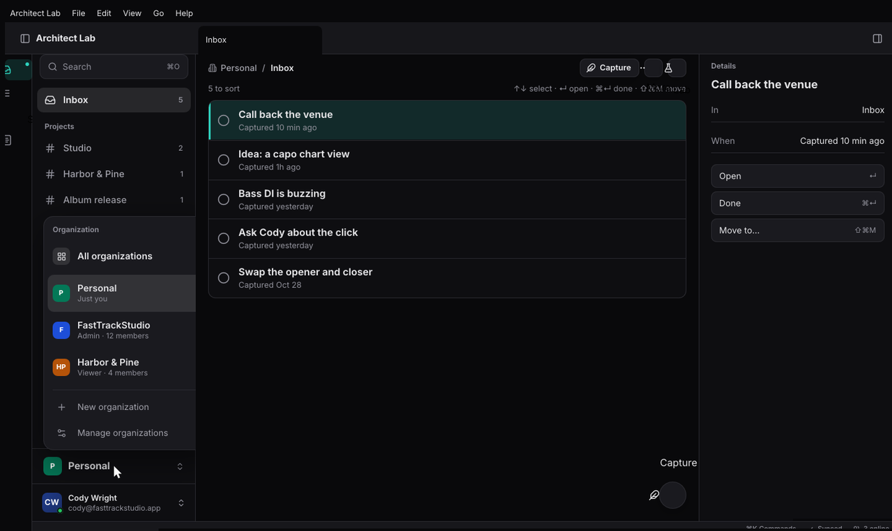

## The workspace's primitives: every kind of tab

`architect-workspace` has one component, `WorkspaceView`, and a model whose
operations are every kind of arrangement (`features/workspace/src/ops.rs`).
The person makes them with gestures; your code makes the same ones on a
`Workspace` value, for a screenset or a command. Each below is what a person
does, then the call.

**Tab groups.** Each group has its own tab bar, a +, and a menu. Open a pane
as a tab beside the active one:

```rust
let _ = w.open(Pane::new("note-1", "note", "Today"), Target::Tab);
```

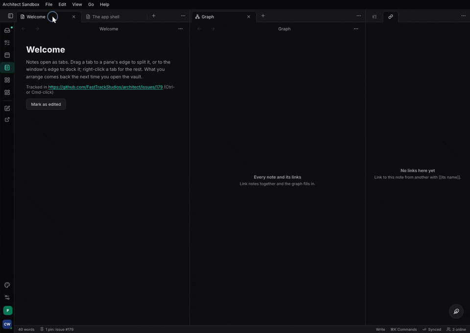

**Splits.** Drag a tab to a group's edge, or Split right from its menu:

```rust
let _ = w.open(Pane::new("graph", "graph", "Graph"), Target::Split(Side::Right));
```

Dividers drag; a double click evens them (`even`).

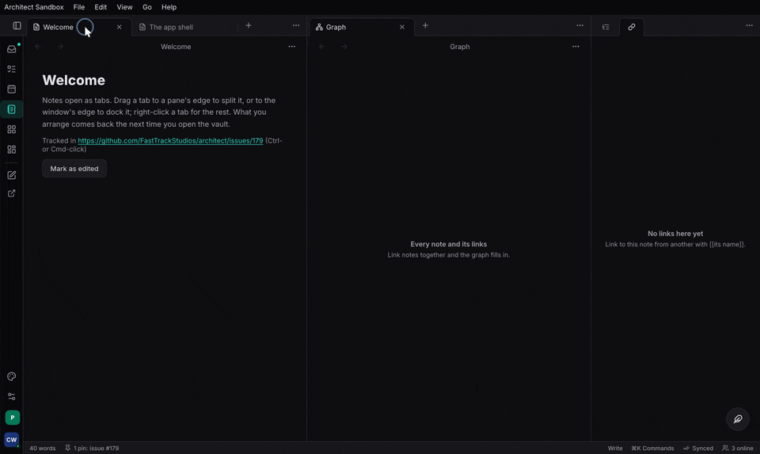

**Reorder and move.** Drag a tab along its bar, or onto another group's bar
or middle (`move_pane(&pane, Dest::Group { group, index })`).

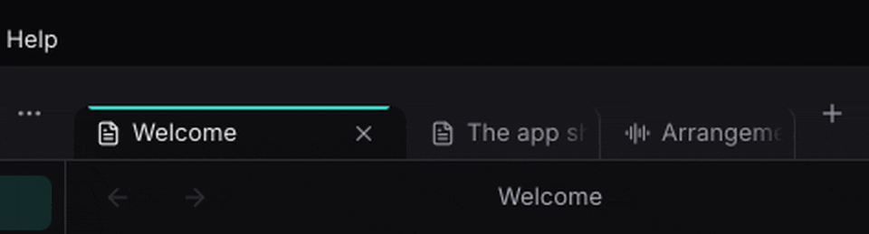

**Stacked tabs.** A group's menu turns stacking on: its tabs become panes
side by side in a strip that scrolls sideways, each sliding over the ones
before it and leaving its spine (its title, written down the edge):

```rust
if let Some(g) = w.active_group() {
    let _ = w.set_stacked(g, true);
}
```

That is the lab's "Mix" screenset (`apps/lab/ui/src/vault.rs` `mix_workspace`).

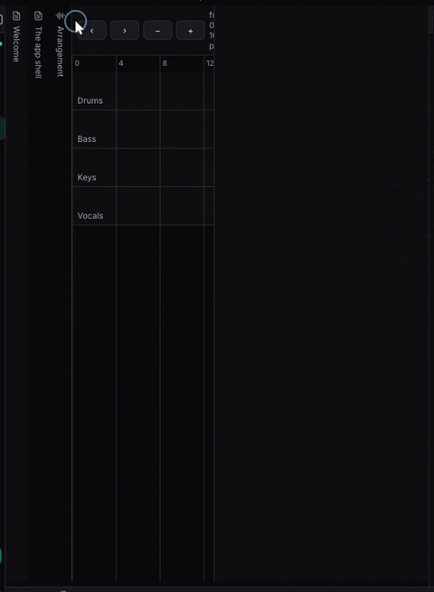

**Docks and the ribbon.** Left, right and bottom docks hold groups of their
own behind a ribbon of view icons and pinned commands; each docks open,
collapses to its icons, or hides:

```rust
let _ = w.open(Pane::new("files", "files", "Files"), Target::Dock(Side::Left));
let _ = w.set_dock_shown(Side::Bottom, Shown::Collapsed);
```

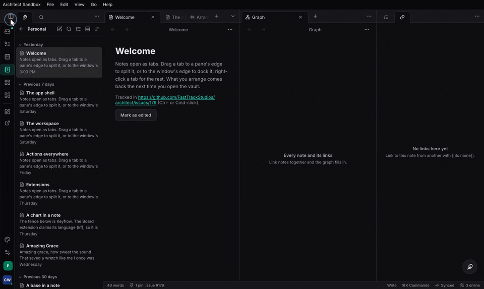

**Floats.** A pane floating over the window: drag by its title, snap to the
top (maximised) or an edge (half, or a docked panel), minimise to a chip:

```rust
let _ = w.open(Pane::new("meter", "meter", "Meter"), Target::Float(Rect::new(520.0, 120.0, 260.0, 160.0)));
let _ = w.minimise(&PaneId::new("meter"));
```

<!-- media: workspace-float-snap — a float dragged to the left edge half-tiles, to the top maximises, then minimises to a chip -->

**Pop-out windows.** A tab dragged out of the window, or "Move to new
window", opens an OS window of its own on a desk (with the `native`
launcher); dragged back, or closed, its tabs return:

```rust
let _ = w.open(pane, Target::Window(None));
```

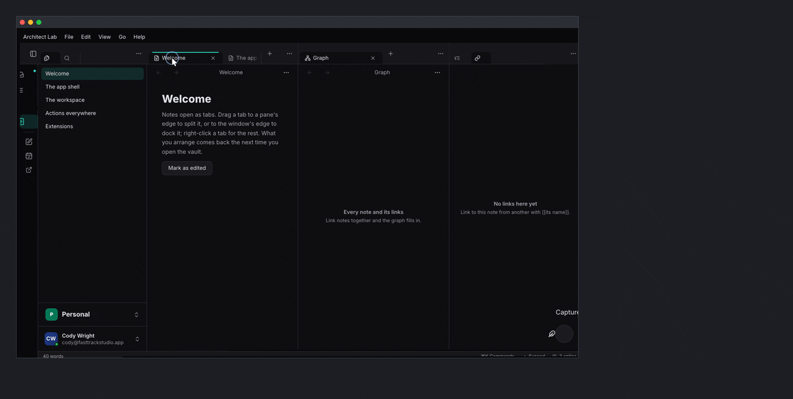

**Pin, link, history.** `set_pinned` keeps a tab from being reused;
`set_link` makes tabs follow each other; `navigate`, `go` are a tab's own
back and forward. `reopen` brings back the last closed tab (⌘⇧T).

**Arrange mode.** Hold W: every pane shows its name and can be dragged,
even one with no tab bar.

<!-- media: workspace-arrange-mode — holding W shows every pane's name; a bare pane is dragged into a group -->

**Screensets.** A layout under a name, recalled by ⌘1–9, one layout per
form class:

```rust
Screensets::default().with_builtins([
    Screenset::new("Write").slot(1).layout(FormClass::Desk, first_workspace()),
    Screenset::new("Mix").slot(2).layout(FormClass::Desk, mix_workspace()),
])
```

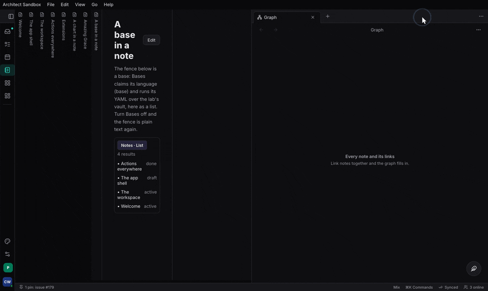

**On a phone** a workspace is one pane at a time with a switcher listing
every pane.

<!-- media: workspace-phone-switcher — on a phone, the pane switcher opened from the page bar and a pane picked -->

`features/workspace/tests/workspace.rs` covers every operation and the
repair after each.

## The commands overlays

`architect-commands` (`features/commands`, feature `ui`), mounted once with
`use_commands_provider` and `CommandLayer` (the
[commands chapter](@/guide/commands.md)):

```rust
let commands = architect_commands::use_commands_provider();
rsx! {
    AppShell { /* … */ }
    architect_commands::CommandLayer {}            // ⌘K palette and ⌘O quick open
}
// open from code:
commands.show(architect_commands::Overlay::Palette);
commands.show(architect_commands::Overlay::QuickOpen);
```

- `CommandPalette`: every command; arguments asked a step at a time;
  `@`, `#`, `?` prefixes.
- `QuickOpen`: every opener at once.
- `ActionListView`: the action list window with its `BindingEditor` and
  `KeymapTools`; mount it as a workspace view
  (`View::new("actions", "Action list", |_| rsx! { architect_commands::ActionListView {} })`).
- `WhichKeyPanel`: what can follow a pending key sequence or a held tool.
- `InWindowMenus` / `NativeMenus`: the menu bar from a `MenuBar`.

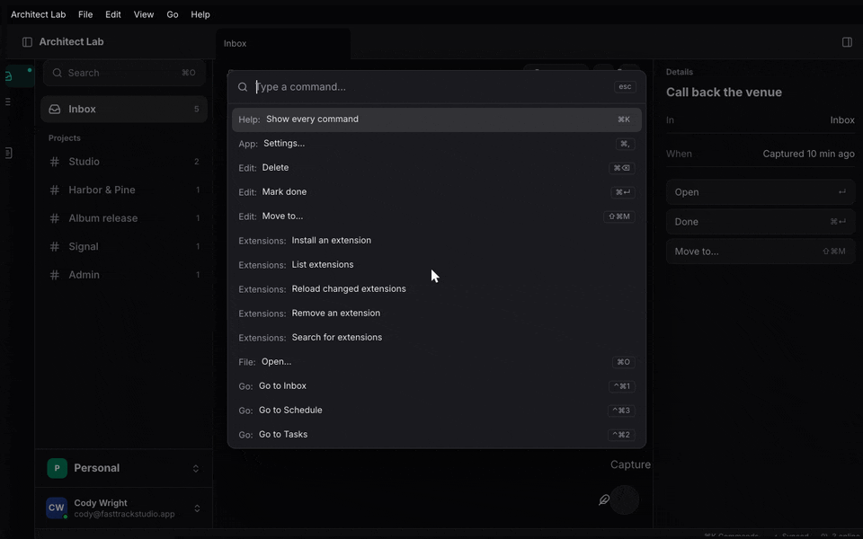
<!-- media: palette-ask-arguments — an action with arguments asking for them a step at a time in the palette -->
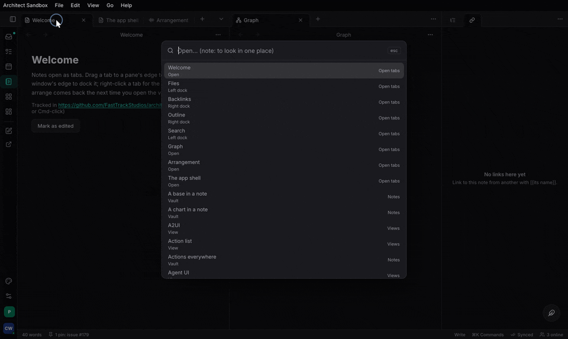
<!-- media: action-list-binding-editor — the action list window recording a new chord, a conflict shown -->
<!-- media: which-key-panel — a key sequence pending, the which-key panel listing what can follow -->
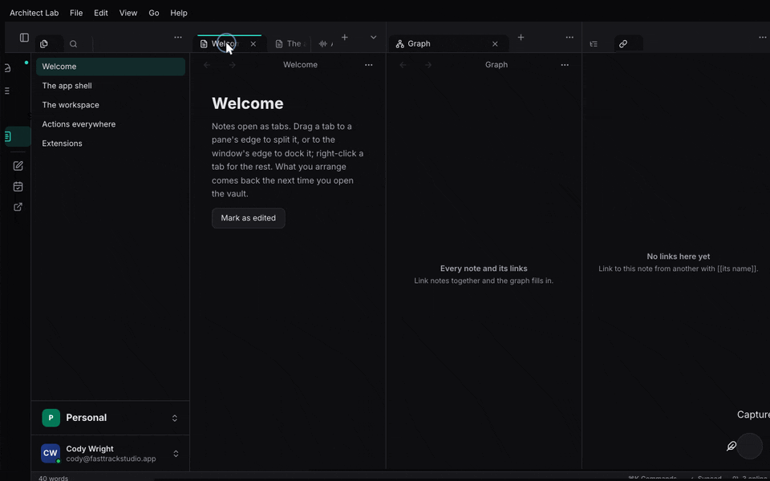

## The settings page

`SettingsPage` (`architect-settings`, feature `ui`), mounted once under
`use_settings_provider` (the [settings chapter](@/guide/settings.md)):

```rust
rsx! {
    AppShell { /* … */ }
    architect_commands::CommandLayer {}
    architect_settings::SettingsPage {}            // ⌘, and the palette's #
}
```

Every row is drawn from its `Setting`'s `Control`: a switch, a select, a
segmented control, a slider with its value in a chip, cards, a stepper, a
text field, a shortcut recorder.

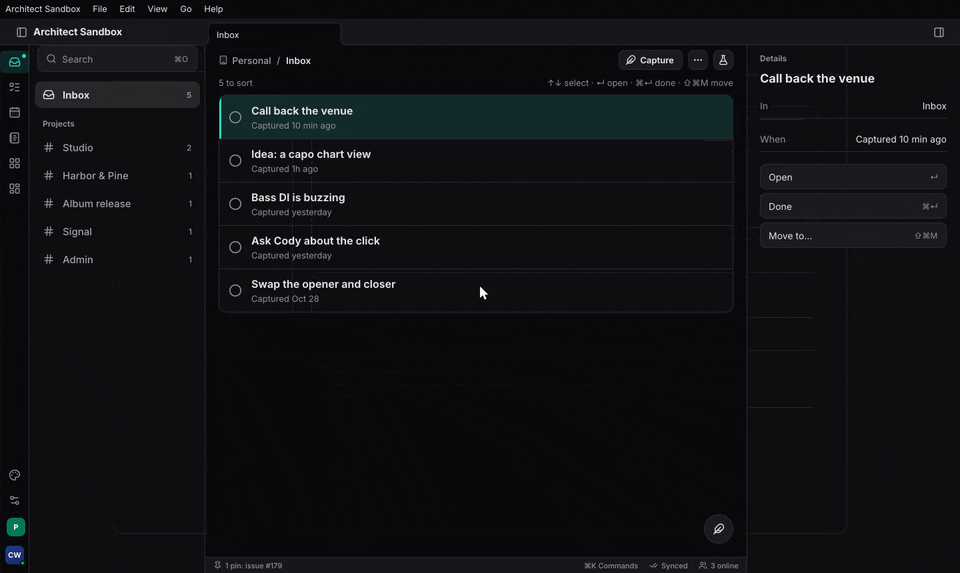
<!-- media: settings-page-phone — the settings page on a phone as an iOS grouped list, a section pushed -->
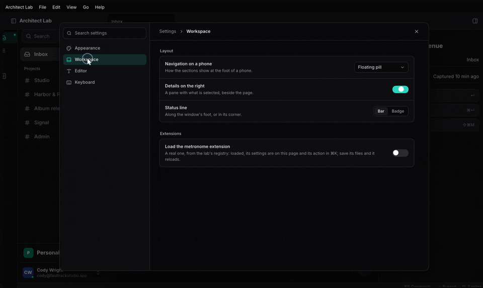

## Browsing them: architect-story

`architect-story` (`features/story`) is a component browser and a visual
regression harness. A story is a function marked `#[story]`; its
arguments are knobs the browser lets you change:

```rust
use architect_story_runtime::story;

#[story(category = "Buttons", name = "primary", knobs(label = "Click me", disabled = false,))]
pub fn button_primary(label: &str, disabled: bool) -> Element {
    rsx! {
        div { class: "p-6 bg-background text-foreground",
            Button { variant: ButtonVariant::Primary, disabled, "{label}" }
        }
    }
}
```

(`features/ui/architect-ui/src/stories.rs`.) Every story lands in one
registry; `Lookbook` (`features/story/architect-story-shell`) is the
browser over it, and `architect-story-snapshots` renders each story
headless in Blitz and diffs it against a committed baseline.

What is honest to say about it today (`features/story/README.md`):
about 40 stories, all `architect-ui`'s own; no app mounts `Lookbook`; the
snapshot and parity harnesses work but nothing runs them as a gate. The
frame's primitives (shell, workspace, commands, settings) have no stories
yet: browse those in the lab, and check them at phone, tablet and desk size
in `features/ui/ui-snapshot` (`features/ui/ui-snapshot/src/scenes.rs`, with
pixel probes in `features/ui/ui-snapshot/tests/pixel_probes.rs`).

## Where to read more

- [The app shell](@/architecture/app-shell.md) and
  [the workspace](@/architecture/workspace.md).
- [Actions everywhere](@/architecture/actions-everywhere.md) and
  [app menus](@/architecture/app-menus.md).
- [Settings: declared once, a page for free](@/architecture/settings-page.md).
- `skills/architect/references/architect-ui.md` and
  `skills/architect/references/blitz-quirks.md`.
